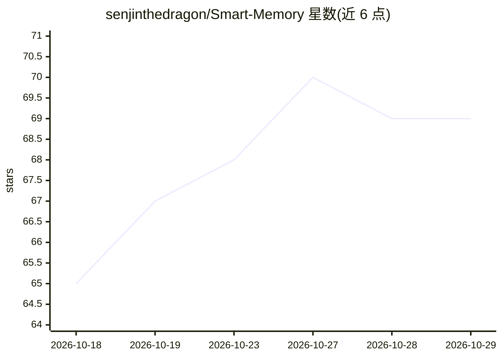

# senjinthedragon/Smart-Memory

⭐ 69 · JavaScript · AGPL-3.0 · 推送 2026-10-01 · [GitHub](https://github.com/senjinthedragon/Smart-Memory) · [官网](https://smartmemory.hatchling.org/) · 个人维护

**给 SillyTavern AI 角色扮演提供多层记忆与叙事上下文的扩展**

SillyTavern 扩展，在聊天后台自动运行，维护多层记忆体系：跨会话长期事实记忆、会话内细节、滚动摘要、场景检测与历史、故事线（含可固定跨聊天的 arc）、由已解决故事线生成的 canon 文档、角色/世界状态快照与关系历史。需要单独配置一个 Memory LLM 做摘要与事实抽取，可选开启语义嵌入去重（如配合 Ollama 的 nomic-embed-text）。支持 1:1 与群聊，群聊中每个角色有独立记忆库。通过 SillyTavern 扩展菜单安装。

## 筛选速览

| 维度 | 判定 | 备注 |
|---|---|---|
| AI 角色 | `ai-ecosystem` | LLM/agent 周边工具 |
| 许可风险 | `viral` | AGPL-3.0 |
| 部署形态 | `None` |  |
| 模型依赖 | local-ok | 支持本地模型 |
| 硬件要求 | — | 无带数字的原话,不猜 |
| 安装摩擦 | `low` | 无编译、无系统依赖或容器化 |
| 成熟度 | — | 结构信号不足 |

## 能力要点

- 长期/会话/短期多层记忆自动抽取与注入，跨会话持久
- 场景转换检测、故事线追踪与可固定（pinned）的跨聊天 arc
- 由已解决故事线合成 canon 文档与角色/世界状态快照
- 记忆激活触发词机制与 token 预算自动调优

## 适用场景

- 长时间角色扮演中保持 AI 对剧情与角色事实的连贯认知
- 群聊中为每个角色维护独立记忆与关系状态
- 跨多个聊天章节推进同一故事时保留未决线索

## 场景标签

`Agent 记忆` · 领域:Agent 开发

## 证据(README 行号)

> L6: Give your AI a memory that lasts. Smart Memory is a SillyTavern extension that quietly works in the background, keep
> L49: Smart Memory needs a language model to do its work - summarizing, extracting facts, generating recaps. It runs this
> L53: Embeddings let Smart Memory compare memories by meaning rather than exact wording, which catches far more duplicate

## 星数曲线

2026-10-18 65 → 2026-10-29 69（+4）

---
*卡片 v1 · prompt 1.4 · 生成 2026-10-24 · 置信度 high · 依据 README sha `d5551ac6f96f` · [字段定义](../../DATASET.md)*
