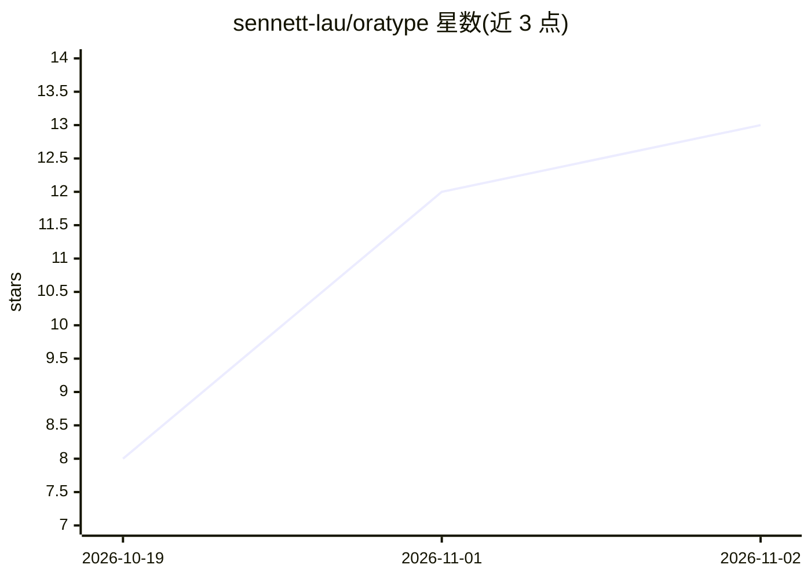

# sennett-lau/oratype

⭐ 13 · Rust · MIT · 推送 2026-10-29 · [GitHub](https://github.com/sennett-lau/oratype) · [官网](https://oratype.sennettlau.me) · 个人维护

**macOS 语音输入工具：说话即得整理好的文字**

面向 macOS 用户的语音键盘：按快捷键说话，将语音转成文字，去除语气词、应用自我修正、加标点后粘贴到光标处；支持翻译和针对选中文本提问。Apple Silicon 上可完全本地运行：内置 whisper.cpp 做语音识别，llama.cpp server 做 AI 润色，一键下载模型；也可连接任何 OpenAI 兼容服务（Ollama、LM Studio、OpenAI、Groq、OpenRouter 等）。语言预设为 Markdown 文件，带语言路由器区分所说语言。DMG 安装包未签名，需手动放行。

## 筛选速览

| 维度 | 判定 | 备注 |
|---|---|---|
| AI 角色 | `ai-native` | 本体是模型或模型工具 |
| 许可风险 | `permissive` | MIT |
| 部署形态 | `desktop` | 安装包/桌面程序 |
| 模型依赖 | local-ok | 支持本地模型 |
| 硬件要求 | — | 无带数字的原话,不猜 |
| 安装摩擦 | `low` | 无编译、无系统依赖或容器化 |
| 成熟度 | — | 结构信号不足 |

## 能力要点

- whisper.cpp 语音识别 + llama.cpp AI 润色，Apple Silicon 全本地运行
- 语言预设（Markdown 文件）与语言路由器
- 支持任意 OpenAI 兼容服务器及 Qwen Cloud、ElevenLabs 语音 API
- 语音翻译（最多 3 个目标语言，录音中切换）与选中文本问答

## 适用场景

- 在任何 app 中用语音代替打字输入
- 说话时同步翻译成另一种语言粘贴
- 全本地运行语音输入，不外发音频

## 场景标签

`语音识别` · 领域:感知与多模态

## 证据(README 行号)

> L17: OraType is a voice keyboard for macOS. Hold or tap a shortcut and speak. OraType turns your
> L85: whisper.cpp handles speech recognition inside the app,

## 星数曲线

2026-10-19 8 → 2026-11-02 13（+5）

---
*卡片 v1 · prompt 1.4 · 生成 2026-11-01 · 置信度 high · 依据 README sha `328b6f594520` · [字段定义](../../DATASET.md)*
