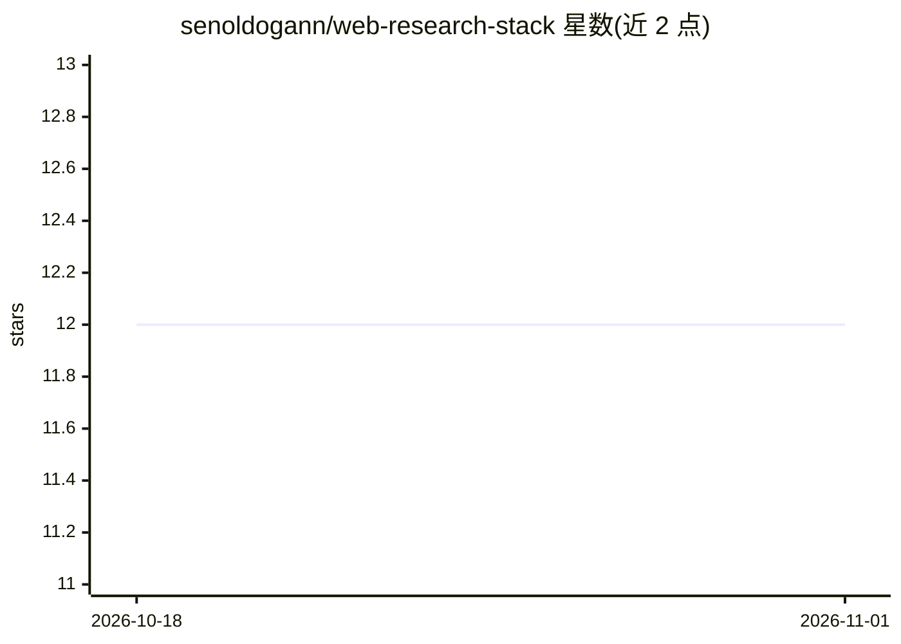

# senoldogann/web-research-stack

⭐ 12 · Python · MIT · 推送 2026-10-25 · [GitHub](https://github.com/senoldogann/web-research-stack) · 个人维护

**面向 AI agent 的网页搜索/抓取 MCP 服务器与 CLI/REST 工具**

以 Python 包 dotagent-web-research 提供的 Web 研究工具集：一个 MCP 服务器（web_search/web_scrape/web_map/web_extract/web_health/web_crawl_* 等 9 个工具，stdio 传输）与一个 CLI/REST 服务器。后端为 FastAPI，前端为 Next.js。搜索支持 DuckDuckGo、Brave、Serper（API key 开启）、Google 等多级回退；抓取带日期置信度、soft_404 判定、存档恢复与 Camoufox 隐身浏览器回退以应对反爬。供需要联网检索能力的 agent（如 macOS agent Dot）与开发者使用。

## 筛选速览

| 维度 | 判定 | 备注 |
|---|---|---|
| AI 角色 | `ai-ecosystem` | LLM/agent 周边工具 |
| 许可风险 | `permissive` | MIT |
| 部署形态 | `library` | 以包/库形式分发 |
| 模型依赖 | — | README 未给出锁定关系 |
| 硬件要求 | — | 无带数字的原话,不猜 |
| 安装摩擦 | `low` | 无编译、无系统依赖或容器化 |
| 成熟度 | — | 结构信号不足 |

## 能力要点

- MCP 服务器提供 web_search/web_scrape/web_map/web_crawl_* 等 9 个工具
- 多搜索源回退与提供方健康状态跟踪（冷却/降级/延迟）
- 被反爬拦截后用 Camoufox（Firefox）重读页面，含 bot 检测应对与下载量/限制说明
- 页面日期信号加权、存档/AMP/Feed 多路恢复读取

## 适用场景

- 为 MCP 客户端/agent 提供联网搜索与网页抓取工具
- 爬取并提取网页内容用于研究，含引用与日期置信度
- 对被 bot 检测拦截的站点做回退读取

## 场景标签

`网页抓取` · 领域:效率与自动化

## 证据(README 行号)

> L17: The MCP server for web search and reading that Dot, the always-on agent for macOS, uses ships as a Python package, 
> L25: It installs two commands: `web-research-mcp`, the MCP server over stdio (tools `web_search`, `web_scrape`, `web_map

## 星数曲线

2026-10-18 12 → 2026-11-01 12（+0）

---
*卡片 v1 · prompt 1.4 · 生成 2026-11-01 · 置信度 high · 依据 README sha `0b6b854056bc` · [字段定义](../../DATASET.md)*
