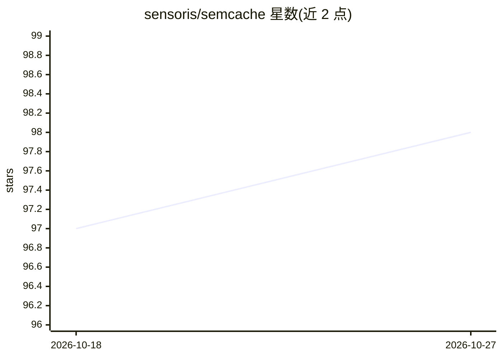

# sensoris/semcache

⭐ 98 · Rust · MIT · 推送 2026-01-02 · [GitHub](https://github.com/sensoris/semcache) · [官网](https://semcache.io) · 组织维护

**面向 LLM 应用的语义缓存层：复用相似回答、降低开销**

部署为 HTTP 代理或作为库使用的语义缓存层：请求先按语义相似度检索已缓存的回答，命中则直接返回，减少对 LLM API 的重复调用，从而降低延迟与费用。以 Docker 镜像方式运行，提示词、响应与向量库全部存于内存，采用 LRU 淘汰策略；支持 OpenAI、Anthropic、Gemini 等 API 的代理模式，也提供 pip/npm 客户端以 cache-aside 方式接入。自带 Prometheus 指标与 /admin 监控面板，另有托管版提供持久化存储与 SLA 支持。README 声明项目仍处于 beta 阶段。

## 筛选速览

| 维度 | 判定 | 备注 |
|---|---|---|
| AI 角色 | `ai-ecosystem` | LLM/agent 周边工具 |
| 许可风险 | `permissive` | MIT |
| 部署形态 | `self-host` | docker 或自建部署 |
| 模型依赖 | — | README 未给出锁定关系 |
| 硬件要求 | — | 无带数字的原话,不猜 |
| 安装摩擦 | `low` | 无编译、无系统依赖或容器化 |
| 成熟度 | `idea` | |

## 能力要点

- 按语义相似度命中缓存回答，减少重复 LLM API 调用
- HTTP 代理模式可作为现有 SDK 端点的替换
- 全内存存储（提示词/响应/向量库）与 LRU 淘汰策略
- Prometheus 指标、Grafana 面板与内置 /admin 监控

## 适用场景

- 我重复调用 LLM API，想通过缓存降低费用和延迟
- 不改代码，把 SDK 的 base_url 指向缓存代理即可生效
- 在服务里用 cache-aside 客户端自行写入/读取缓存

## 场景标签

 · 领域:LLM 基础设施

## 证据(README 行号)

> L3: `semcache` is a semantic caching layer for your LLM applications.
> L48: Semcache accelerates LLM applications by caching responses based on semantic similarity.
> L50: When you make a request Semcache first searches for previously cached answers to similar prompts and delivers them 

## 星数曲线

2026-10-18 97 → 2026-10-27 98（+1）

---
*卡片 v1 · prompt 1.4 · 生成 2026-10-23 · 置信度 high · 依据 README sha `ca47a642e638` · [字段定义](../../DATASET.md)*
