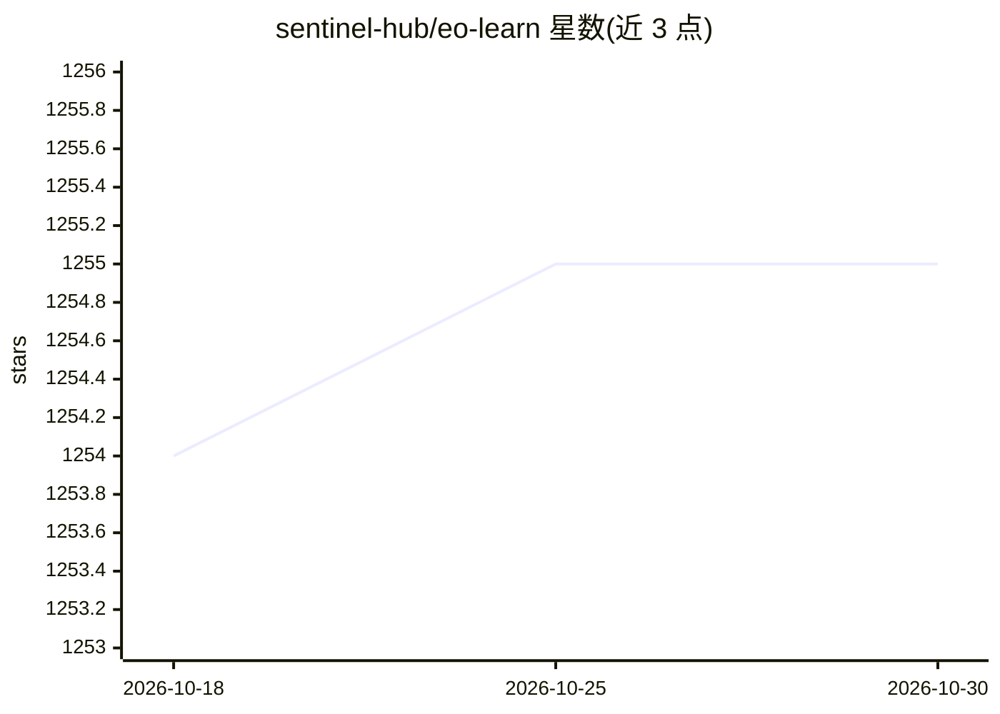

# sentinel-hub/eo-learn

⭐ 1,255 · Python · MIT · 推送 2026-09-09 · [GitHub](https://github.com/sentinel-hub/eo-learn) · [官网](https://eo-learn.readthedocs.io/en/latest/) · 组织维护

**面向遥感卫星影像与机器学习的 Python 地球观测处理框架**

eo-learn 是一组开源 Python 包，将卫星影像等时空数据以 NumPy 数组形式组织，通过 EOPatch/EOTask/EOWorkflow 等构建模块把云端掩膜、图像配准、特征提取、分类等处理步骤串成工作流，可从 Sentinel Hub 服务获取数据或本地存取。它面向遥感研究人员与数据科学开发者，是连接地球观测领域与 Python 机器学习生态的桥梁框架；模块化的 extra 依赖需另行安装，Linux/macOS/Windows 安装前建议先装 GDAL 等系统库。

## 筛选速览

| 维度 | 判定 | 备注 |
|---|---|---|
| AI 角色 | `ai-ecosystem` | LLM/agent 周边工具 |
| 许可风险 | `permissive` | MIT |
| 部署形态 | `self-host` | docker 或自建部署 |
| 模型依赖 | — | README 未给出锁定关系 |
| 硬件要求 | — | 无带数字的原话,不猜 |
| 安装摩擦 | `low` | 无编译、无系统依赖或容器化 |
| 成熟度 | — | 结构信号不足 |

## 能力要点

- EOPatch/EOTask/EOWorkflow 模块化构建遥感处理工作流
- 覆盖 IO、几何、配准、掩膜、特征、ML 工具、可视化等模块
- 支持 pip/conda-forge 安装与含 Jupyter 环境的 Docker 镜像
- 通过 Sentinel Hub 服务获取卫星数据并可扩展至 Batch Processing API

## 适用场景

- 搭建卫星影像土地覆盖分类等遥感机器学习工作流
- 对卫星影像做云掩膜、配准与特征提取处理
- 在 Jupyter 环境中快速试验遥感数据处理流程

## 场景标签

`图像视频处理` · 领域:感知与多模态

## 证据(README 行号)

> L23: **`eo-learn`** is a collection of open source Python packages that have been developed to seamlessly access and pro
> L31: **`eo-learn`** _library acts as a bridge between Earth observation/Remote sensing field and Python ecosystem for da
> L45: - **`ml-tools`** - Various tools that can be used before or after the machine learning process.

## 星数曲线

2026-10-18 1,254 → 2026-10-30 1,255（+1）

---
*卡片 v1 · prompt 1.4 · 生成 2026-10-21 · 置信度 high · 依据 README sha `ee193461034d` · [字段定义](../../DATASET.md)*
