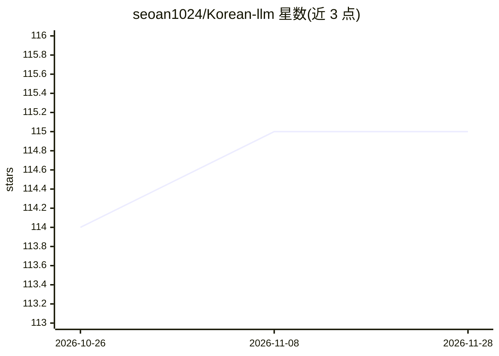

# seoan1024/Korean-llm

⭐ 115 · Python · GPL-3.0 · 推送 2026-11-27 · [GitHub](https://github.com/seoan1024/Korean-llm) · 个人维护

**研究者用 PyTorch 从零实现并训练韩语 LLM 的流水线**

面向韩语 LLM 研究的训练流水线项目（v4），将 v1~v3 实验整理为 pretrain → SFT 两个阶段，支持 argparse CLI 指定数据集与配置、streaming cache 处理大数据、validation split 与 loss 记录、SFT response-only labels。模型结构为 RMSNorm/RoPE/SwiGLU/KV-cache，约 1B 级，支持 BF16 与可选 8-bit AdamW。研究结果经 Base/Beta 演进为 Hanok LLM 发布栈；实际参数量与权重发布状态需查看对应模型卡。

## 筛选速览

| 维度 | 判定 | 备注 |
|---|---|---|
| AI 角色 | `ai-native` | 本体是模型或模型工具 |
| 许可风险 | `viral` | GPL-3.0 |
| 部署形态 | `library` | 以包/库形式分发 |
| 模型依赖 | — | README 未给出锁定关系 |
| 硬件要求 | — | 无带数字的原话,不猜 |
| 安装摩擦 | `low` | 无编译、无系统依赖或容器化 |
| 成熟度 | — | 结构信号不足 |

## 能力要点

- pretrain → SFT 两阶段或手动选择的训练流水线，CLI 指定 dataset/config
- SFT 使用 response-only labels，减少 instruction leakage
- 模型结构含 RMSNorm、RoPE、SwiGLU、KV-cache、tied embeddings
- 支持 --no-gui 服务器/自动运行与 model-only resume

## 适用场景

- 从零实现并训练一个韩语 LLM 做研究实验
- 在自有韩语语料上跑 pretrain 与 SFT 流程
- 复现 Base → Beta 的模型发布流程

## 场景标签

`模型训练` `微调` · 领域:训练与推理

## 证据(README 行号)

> L18:     A[📚 Pretraining 한국어 코퍼스] --> B[💾 pretrain checkpoint]
> L19:     B --> C[🎯 SFT Instruction 데이터]
> L49: python korean_llm_advanced_v4.py --stage auto --dataset AdaMLLab/KorMix --samples-per-dataset 10000 --no-gui

## 星数曲线

2026-10-26 114 → 2026-11-28 115（+1）

---
*卡片 v1 · prompt 1.4 · 生成 2026-11-28 · 置信度 high · 依据 README sha `4796888de28d` · [字段定义](../../DATASET.md)*
