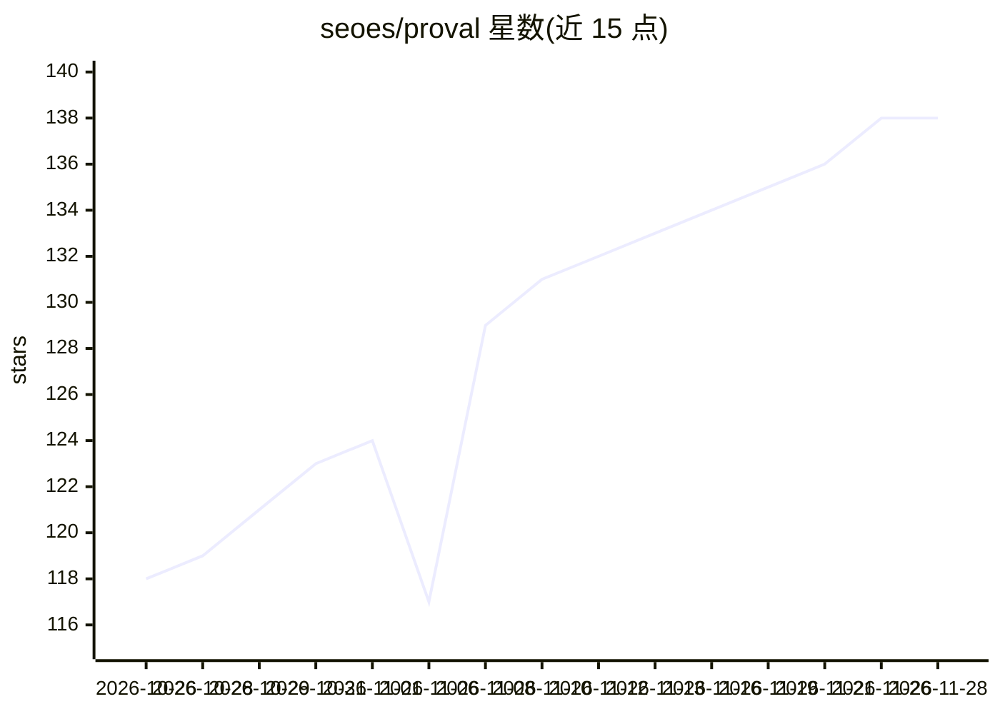

# seoes/proval

⭐ 138 · TypeScript · AGPL-3.0 · 推送 2026-11-25 · [GitHub](https://github.com/seoes/proval) · [官网](https://proval.app) · 个人维护

**自托管 LLM 代码评审 Agent：接入自有 Git 平台审 PR 和 issue**

部署在自己基础设施上的代码评审 Agent：通过 Webhook 连接 GitLab、Forgejo、GitHub（Gitea/Codeberg 经 Forgejo 兼容 API），对 PR 读取 diff、按变更文件分组、用子 Agent 各自探索代码库后写出按严重性分组的评审意见，支持行内评论、线程回复与 issue 回复，并记录 token 用量以追踪成本。模型侧走 OpenAI 兼容 API 或 Anthropic Messages API，可用 Ollama/llama.cpp 等本地模型或经 OAuth 登录 ChatGPT 订阅。数据存 SQLite（WAL 模式），推荐 Docker Compose 部署，Kubernetes 需单副本本地盘存储。AGPLv3 许可，作者自述仍处早期开发阶段。

## 筛选速览

| 维度 | 判定 | 备注 |
|---|---|---|
| AI 角色 | `ai-ecosystem` | LLM/agent 周边工具 |
| 许可风险 | `viral` | AGPL-3.0 |
| 部署形态 | `self-host` | docker 或自建部署 |
| 模型依赖 | local-ok | 支持本地模型 |
| 硬件要求 | — | 无带数字的原话,不猜 |
| 安装摩擦 | `low` | 无编译、无系统依赖或容器化 |
| 成熟度 | `idea` | |

## 能力要点

- PR diff 分组评审：子 Agent 独立探索代码库，捕捉跨文件问题
- 支持 GitLab、Forgejo、GitHub 三类 Git 平台及行内/线程评论
- OpenAI 兼容与 Anthropic API，可用 Ollama、llama.cpp 本地模型
- 活动日志记录 token 用量以追踪模型成本

## 适用场景

- 在内网/homelab 环境里对个人 GitLab 的 PR 做自动评审
- 替代外部评审 SaaS，让代码不出自建基础设施
- 用本地模型跑代码评审以保持数据私密

## 场景标签

`代码审查` · 领域:编码与开发

## 证据(README 行号)

> L5: A Self-hosted LLM code review agent. Connect it to your Git host, bring your own model, and let it review pull reque
> L17:  Proval works with OpenAI-compatible Chat Completions and Responses APIs and the Anthropic Messages API, so you can

## 星数曲线

2026-10-26 118 → 2026-11-28 138（+20）

---
*卡片 v1 · prompt 1.4 · 生成 2026-11-27 · 置信度 high · 依据 README sha `e2d5b2955d7c` · [字段定义](../../DATASET.md)*
