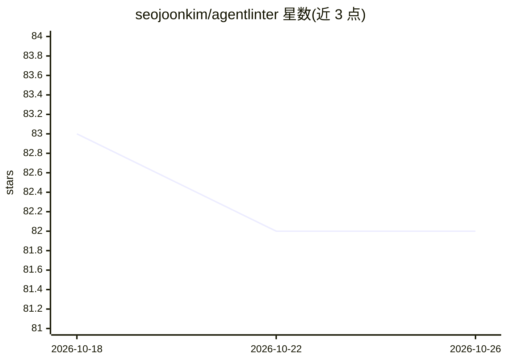

# seojoonkim/agentlinter

⭐ 82 · TypeScript · 推送 2026-08-14 · [GitHub](https://github.com/seojoonkim/agentlinter) · [官网](https://agentlinter.vercel.app) · 个人维护 · 中文 README

**AI agent 配置文件的 lint 工具：扫描、打分并自动修复 AGENTS.md/CLAUDE.md**

面向使用 AI 编码 agent 的开发者的 CLI 工具，将 agent 配置文件当作代码进行静态检查：扫描 CLAUDE.md、SOUL.md、TOOLS.md、技能文件等，按 8 个维度输出 0–100 评分，检测模糊指令、20+ 种密钥泄露模式、跨文件矛盾、位置风险（规则埋在长文件中部）、token 预算超标等 38+ 条规则，多数问题可通过 --fix 自动修复。支持 Claude Code、OpenClaw、Cursor、Copilot 等框架格式互导，韩语文档有专门 token 修正。运行需 Node 18+，npx 一条命令运行，无需 API key。

## 筛选速览

| 维度 | 判定 | 备注 |
|---|---|---|
| AI 角色 | `ai-ecosystem` | LLM/agent 周边工具 |
| 许可风险 | `none` | — |
| 部署形态 | `library` | 以包/库形式分发 |
| 模型依赖 | — | README 未给出锁定关系 |
| 硬件要求 | — | 无带数字的原话,不猜 |
| 安装摩擦 | `low` | 无编译、无系统依赖或容器化 |
| 成熟度 | — | 结构信号不足 |

## 能力要点

- 8 维度 0–100 评分体系，38+ 条规则
- 密钥泄露扫描（25 种模式）与提示注入防御检查
- Position Risk Warning：检测位于长文件中部易被 LLM 忽略的规则
- --fix 自动修复与多框架配置导出（Cursor/Copilot 等）

## 适用场景

- 检查 CLAUDE.md/AGENTS.md 中的模糊指令与矛盾配置
- 防止 API 密钥等敏感信息被提交进 agent 配置文件
- 评估 agent 配置的 token 消耗并压缩冗余内容
- 将 CLAUDE.md 转换为 Cursor/Copilot 等其他框架格式

## 场景标签

`提示工程` `网络安全` · 领域:Agent 开发

## 证据(README 行号)

> L5:  ESLint for AI Agents — Score, diagnose, and auto-fix your entire agent workspace.
> L27: **AgentLinter treats your agent config as code** — scanning, scoring, and fixing it with the same rigor you'd apply
> L45: npx agentlinter

## 星数曲线

2026-10-18 83 → 2026-10-26 82（-1）

---
*卡片 v1 · prompt 1.4 · 生成 2026-10-24 · 置信度 high · 依据 README sha `1342d97fff4b` · [字段定义](../../DATASET.md)*
