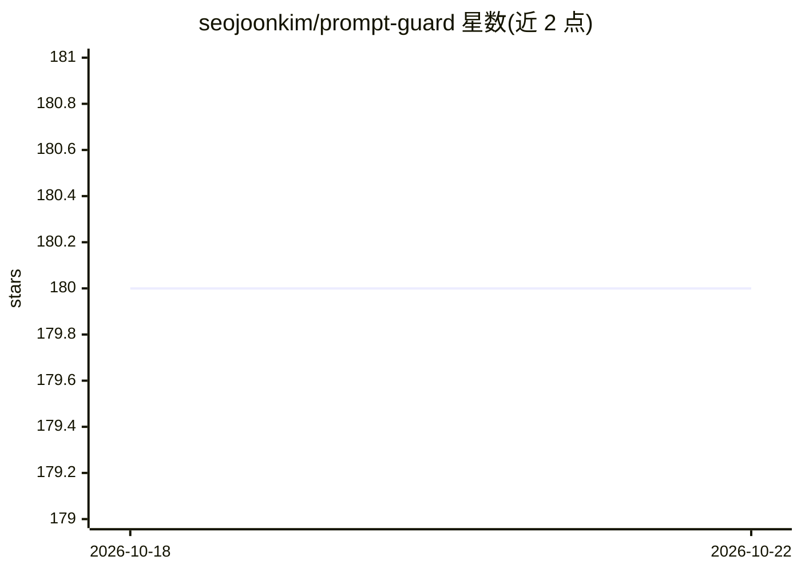

# seojoonkim/prompt-guard

⭐ 180 · Python · MIT · 推送 2026-04-22 · [GitHub](https://github.com/seojoonkim/prompt-guard) · 个人维护

**保护 AI agent 免受提示注入攻击的防御库**

面向 LLM agent 的提示注入防御 Python 库：内置 840+ 检测模式，覆盖越狱、注入、MCP 滥用、反向 shell、隐蔽外泄等攻击类型，支持 10 种语言、混淆编码解码（Base64/ROT13/URL 等）、严重度分级与输出 DLP 脱敏。提供 CLI、Python API 与 Docker 容器化 API 服务，可接入 LangChain 等框架。默认通过 API 拉取最新模式，断网时以内置模式完全离线运行；可选 LLM 语义检测（BYOK 或本地 Ollama/vLLM 等）。

## 筛选速览

| 维度 | 判定 | 备注 |
|---|---|---|
| AI 角色 | `ai-ecosystem` | LLM/agent 周边工具 |
| 许可风险 | `permissive` | MIT |
| 部署形态 | `self-host` | docker 或自建部署 |
| 模型依赖 | local-ok | 支持本地模型 |
| 硬件要求 | — | 无带数字的原话,不猜 |
| 安装摩擦 | `low` | 无编译、无系统依赖或容器化 |
| 成熟度 | — | 结构信号不足 |

## 能力要点

- 840+ 检测模式，10 种语言，严重度 SAFE→CRITICAL 五级分级
- 输出 DLP：扫描 LLM 回复中的凭据泄露并先行脱敏
- 混淆检测：Homoglyph/Base64/Hex/ROT13/URL/HTML 实体/Unicode
- 遵循 SHIELD.md 威胁分类标准，提供 JSONL SIEM 日志

## 适用场景

- 在 agent 处理用户输入前拦截提示注入与越狱攻击
- 扫描 LLM 输出防止 API key 等凭据泄露
- 通过部署蜜罐 token 检测系统提示词被提取

## 场景标签

 · 领域:AI 安全/LLM 基础设施

## 证据(README 行号)

> L13:  Prompt injection defense for any LLM agent
> L16:  Works with Clawdbot, LangChain, AutoGPT, CrewAI, or any LLM-powered system.

## 星数曲线

2026-10-18 180 → 2026-10-22 180（+0）

---
*卡片 v1 · prompt 1.4 · 生成 2026-10-22 · 置信度 high · 依据 README sha `813bc9c89b75` · [字段定义](../../DATASET.md)*
