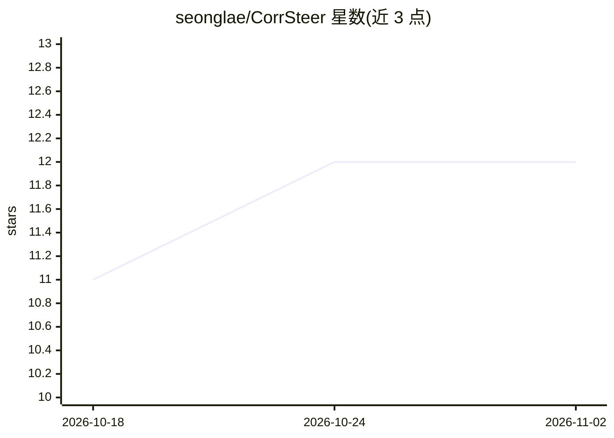

# seonglae/CorrSteer

⭐ 12 · Python · MIT · 推送 2026-05-18 · [GitHub](https://github.com/seonglae/CorrSteer) · [官网](https://seongland.com/article/corrsteer) · 个人维护

**生成时 LLM 操纵方法实现：基于相关 SAE 特征选择**

ICML 2026 论文 CorrSteer 的官方实现：一种生成时 LLM steering 方法，从生成时激活中基于相关性选择稀疏自编码器（SAE）特征进行操纵，支持流式计算（O(1) 内存复杂度）与三种多层策略（CorrSteer-S/A/P），并提出副作用比率（SER）度量非预期变化。提供 train.py/eval.py 脚本，在 MMLU 等任务上训练与评测，模型配置含 gemma2b。以 Python 源码仓库形式提供，通过 uv 管理环境安装。

## 筛选速览

| 维度 | 判定 | 备注 |
|---|---|---|
| AI 角色 | `ai-native` | 本体是模型或模型工具 |
| 许可风险 | `permissive` | MIT |
| 部署形态 | `library` | 以包/库形式分发 |
| 模型依赖 | — | README 未给出锁定关系 |
| 硬件要求 | — | 无带数字的原话,不猜 |
| 安装摩擦 | `low` | 无编译、无系统依赖或容器化 |
| 成熟度 | — | 结构信号不足 |

## 能力要点

- 从生成时激活中做基于相关性的特征选择
- 流式计算，O(1) 内存复杂度
- 三种多层策略 CorrSteer-S/A/P
- 副作用比率（SER）度量非预期改变

## 适用场景

- 研究人员复现或扩展生成时 steering 实验
- 在 MMLU 等基准上评测特征操纵效果
- 机制可解释性研究中分析 SAE 特征与行为的相关性

## 场景标签

 · 领域:LLM 可解释性研究

## 证据(README 行号)

> L10: Implementation of CorrSteer, a generation-time steering method using correlated Sparse Autoencoder (SAE) features.
> L14: - **Correlation-based feature selection** from generation-time activations

## 星数曲线

2026-10-18 11 → 2026-11-02 12（+1）

---
*卡片 v1 · prompt 1.4 · 生成 2026-11-01 · 置信度 high · 依据 README sha `534528293672` · [字段定义](../../DATASET.md)*
