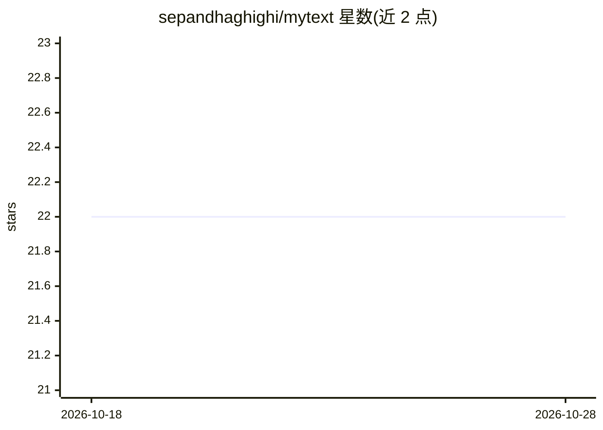

# sepandhaghighi/mytext

⭐ 22 · Python · MIT · 推送 2026-10-25 · [GitHub](https://github.com/sepandhaghighi/mytext) · 个人维护

**面向 CLI 与 Python 的轻量 LLM 文本改写/润色/语气调整工具**

MyText 是一个用 Python3 编写的文本处理工具，调用多家 LLM 提供商（Google AI Studio、Cloudflare Workers AI、OpenRouter、Cerebras、Groq、NVIDIA）对文本执行润色、改写、语法修正、摘要、简化、加表情、缩短等 8 种模式，并支持 12 种输出语气（如 formal、casual、biblical、viking 等）。提供命令行界面（单次运行与交互循环两种方式）和最小化 Python API，通过环境变量自动检测并选择首个可用的提供商，也可用 --provider/--model 覆盖。配置解析优先级为 CLI 参数 > 环境变量 > 内置默认值。

## 筛选速览

| 维度 | 判定 | 备注 |
|---|---|---|
| AI 角色 | `ai-native` | 本体是模型或模型工具 |
| 许可风险 | `permissive` | MIT |
| 部署形态 | `library` | 以包/库形式分发 |
| 模型依赖 | locked-api |  |
| 硬件要求 | — | 无带数字的原话,不猜 |
| 安装摩擦 | `low` | 无编译、无系统依赖或容器化 |
| 成熟度 | — | 结构信号不足 |

## 能力要点

- 8 种文本处理模式（polish/paraphrase/grammar/summarize 等）
- 12 种输出语气（formal/casual/academic/viking 等）
- 6 家 LLM 提供商支持，按环境变量自动选择首个可用者
- 同时提供 CLI（含交互 loop 模式）与 Python 库两种使用方式

## 适用场景

- 在命令行快速改写或润色一段文字并调整语气
- 把英文邮件改写成正式或随和语气
- 在 Python 程序中调用文本摘要、简化等转换功能

## 场景标签

`AI 写作` · 领域:内容生成

## 证据(README 行号)

> L1: MyText: A Minimal AI-Powered Text Rewriting Tool
> L9:  MyText is a lightweight AI-powered text enhancement tool that rewrites, paraphrases, and adjusts tone using modern 
> L74: ℹ️ Supported modes: `polish`, `paraphrase`, `grammar`, `summarize`, `simplify`, `bulletize`, `shorten`, `emojify`

## 星数曲线

2026-10-18 22 → 2026-10-28 22（+0）

---
*卡片 v1 · prompt 1.4 · 生成 2026-10-27 · 置信度 high · 依据 README sha `52bad8118978` · [字段定义](../../DATASET.md)*
