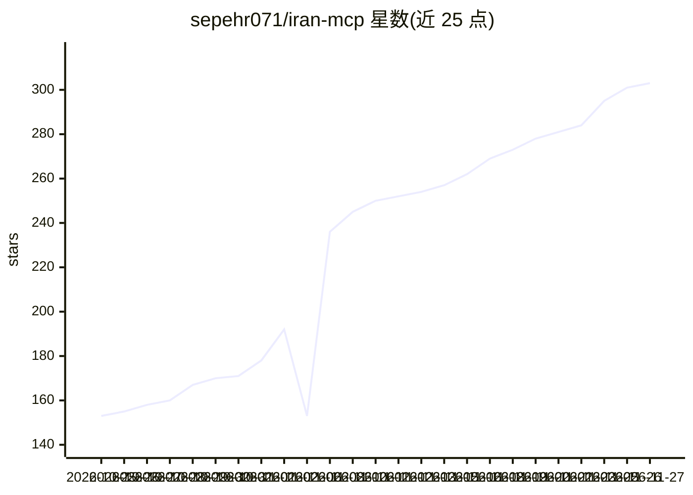

# sepehr071/iran-mcp

⭐ 303 · Python · NOASSERTION · 推送 2026-11-23 · [GitHub](https://github.com/sepehr071/iran-mcp) · [官网](https://mcpfarsi.ir) · 个人维护

**给 AI agent 接入伊朗互联网服务的 96 个 MCP 服务器集合**

将 Digikala、Divar、Snappfood、Neshan、Jobinja 等伊朗网站的非公开 API 封装为 MCP 工具，统一以 Toman 报价，供 Claude、Cursor、GitHub Copilot 等 MCP 客户端的 agent 调用。服务器多为只读、无需登录与 API key，以 PyPI Python 包形式经 uvx 运行，部分由站点官方托管（OAuth 登录）；支持 Claude Code 插件市场安装、Agent Skills 形式分发及按 bundle 组合。部分经济类服务器仅响应伊朗 IP 连接。

## 筛选速览

| 维度 | 判定 | 备注 |
|---|---|---|
| AI 角色 | `ai-ecosystem` | LLM/agent 周边工具 |
| 许可风险 | `none` | NOASSERTION |
| 部署形态 | `library` | 以包/库形式分发 |
| 模型依赖 | — | README 未给出锁定关系 |
| 硬件要求 | — | 无带数字的原话,不猜 |
| 安装摩擦 | `low` | 无编译、无系统依赖或容器化 |
| 成熟度 | — | 结构信号不足 |

## 能力要点

- 96 个 MCP 服务器、1150 个工具，覆盖购物、出行、招聘、法律、税务等类别
- 多数服务器只读、无需账号和 API key，价格统一为 Toman
- 支持 Claude Code 插件、npx skills 及任意 MCP 客户端配置接入
- 提供代理列表与浏览器回退等应对站点反爬的机制

## 适用场景

- 让 Claude 或 Cursor 里的 agent 比价并规划伊朗境内行程
- 在对话中查询伊朗股价、汇率、法律和税务信息
- 为波斯语用户聚合招聘、房产、电影票等站点数据

## 场景标签

`网页抓取` · 领域:效率与自动化

## 证据(README 行号)

> L8: 94 unofficial, open-source Persian-web MCP servers for Digikala, Torob, Divar, Snappfood, Jabama, MrBilit, Alibaba, 
> L153: real (undocumented) API, tests it, and exposes it as clean MCP tools with prices in **Toman**. `exiryab-mcp`,
> L171: Every server is a small Python package on PyPI, run with `uvx`, except

## 星数曲线

2026-10-25 153 → 2026-11-27 303（+150）

---
*卡片 v1 · prompt 1.4 · 生成 2026-11-25 · 置信度 high · 依据 README sha `024059eb4441` · [字段定义](../../DATASET.md)*
