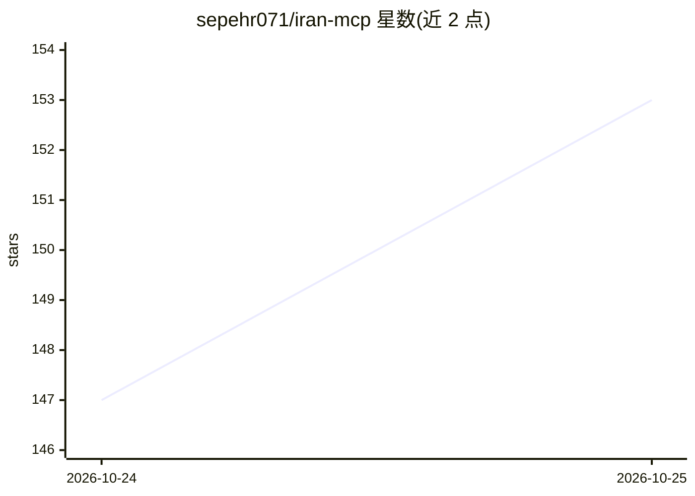

# sepehr071/iran-mcp

⭐ 155 · Python · MIT · 推送 2026-10-24 · [GitHub](https://github.com/sepehr071/iran-mcp) · 个人维护

**39 个伊朗网站 MCP 服务器集，让 AI agent 查询本地购物/出行/价格等信息**

面向伊朗波斯语网站的开源 MCP 服务器合集：36 个非官方服务器映射 Digikala、Torob、Divar、Snappfood、MrBilit、Paziresh24、Taaghche 等网站的未公开 API，另有 ExirYab、Pasavard、SwapWallet 提供的官方服务器，共 39 个服务器、488 个工具。价格统一以 Toman 输出，多数服务器只读、无需账号或 API key。以 PyPI 小包形式用 uvx 运行，可安装为 Claude Code 插件（含技能）或通过任意 MCP 客户端接入；限流应对包括代理列表与可选浏览器回退。

## 筛选速览

| 维度 | 判定 | 备注 |
|---|---|---|
| AI 角色 | `ai-ecosystem` | LLM/agent 周边工具 |
| 许可风险 | `permissive` | MIT |
| 部署形态 | `library` | 以包/库形式分发 |
| 模型依赖 | locked-api |  |
| 硬件要求 | — | 无带数字的原话,不猜 |
| 安装摩擦 | `low` | 无编译、无系统依赖或容器化 |
| 成熟度 | — | 结构信号不足 |

## 能力要点

- 39 个服务器、488 个工具，覆盖购物、分类信息、餐饮、出行、健康、图书、价格与新闻等类别
- 统一价格单位为 Toman，多数服务器只读且无需账号
- 可安装为 Claude Code 插件或经任意 MCP 客户端用 uvx 运行
- 支持代理列表轮换与可选浏览器回退应对站点封锁

## 适用场景

- 让 Claude/Cursor 等 agent 一句话完成机票、住宿、医生的比价与预约查询
- 查询伊朗各电商平台的商品价格与优惠
- 获取黄金、外币、加密货币实时价格及伊朗法律、税务记录

## 场景标签

 · 领域:MCP 服务器/本地生活信息接入

## 证据(README 行号)

> L1: iran-mcp: 39 MCP servers and 488 tools for Iranian shopping, classifieds, food, travel, health, book, course, app, p
> L8: 36 unofficial, open-source Persian-web MCP servers for Digikala, Torob, Divar, Snappfood, Jabama, MrBilit, Paziresh2
> L96: Every server is a small Python package on PyPI, run with `uvx`, except

## 星数曲线

2026-10-24 147 → 2026-10-25 153（+6）

---
*卡片 v1 · prompt 1.4 · 生成 2026-10-23 · 置信度 high · 依据 README sha `cfac18900d99` · [字段定义](../../DATASET.md)*
