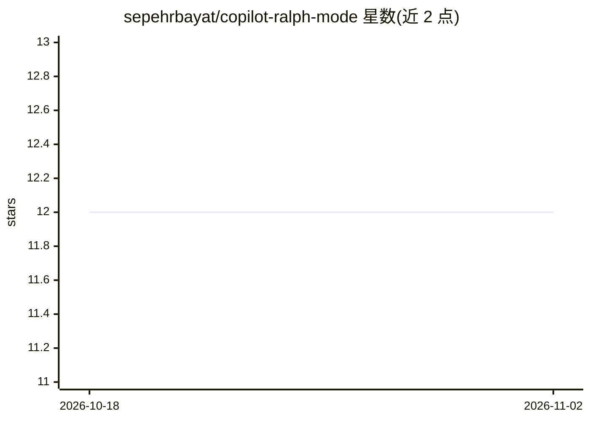

# sepehrbayat/copilot-ralph-mode

⭐ 12 · Python · MIT · 推送 2026-02-13 · [GitHub](https://github.com/sepehrbayat/copilot-ralph-mode) · [官网](https://www.linkedin.com/in/sepehrbayat/) · 个人维护

**围绕 GitHub Copilot CLI 的迭代式自动化开发循环工具**

实现 Ralph Wiggum 技术：用循环反复向 GitHub Copilot CLI 投递任务提示，让 AI 代理迭代改进直至输出完成承诺（<promise>DONE</promise>）。兼容 Copilot CLI 的自定义代理、plan 模式、MCP 服务器与上下文管理；内置 6 个代理、Auto-Agents 动态创建子代理、Skills 技能目录、Hooks 钩子（含环境变量）、断网检测与指数退避恢复、检查点系统及工具审批语法。面向使用 Copilot CLI 的开发者，提供 Dev Container、一键脚本、pip、make 等多种安装方式，跨平台 Python 工具。

## 筛选速览

| 维度 | 判定 | 备注 |
|---|---|---|
| AI 角色 | `ai-ecosystem` | LLM/agent 周边工具 |
| 许可风险 | `permissive` | MIT |
| 部署形态 | `self-host` | docker 或自建部署 |
| 模型依赖 | — | README 未给出锁定关系 |
| 硬件要求 | — | 无带数字的原话,不猜 |
| 安装摩擦 | `low` | 无编译、无系统依赖或容器化 |
| 成熟度 | — | 结构信号不足 |

## 能力要点

- 循环投递提示驱动 Copilot CLI 迭代，以完成承诺结束
- Auto-Agents 可在执行中动态创建子代理
- 6 个钩子点位（pre/post-iteration 等）与环境变量注入
- 断网检测、指数退避与检查点恢复

## 适用场景

- 让 Copilot CLI 自动迭代完成编程任务直到收尾
- 为重复性测试、重构子任务创建专用子代理
- 在迭代节点挂接自动提交或安全扫描钩子

## 场景标签

`编码 Agent` · 领域:编码与开发

## 证据(README 行号)

> L3: > Implementation of the Ralph Wiggum technique for iterative, self-referential AI development loops with GitHub Copi
> L20: Ralph is a development methodology based on continuous AI agent loops. As Geoffrey Huntley describes it: **"Ralph i
> L24: **This implementation is fully compatible with GitHub Copilot CLI**, supporting all its features including custom a

## 星数曲线

2026-10-18 12 → 2026-11-02 12（+0）

---
*卡片 v1 · prompt 1.4 · 生成 2026-11-01 · 置信度 high · 依据 README sha `c93bcede84ff` · [字段定义](../../DATASET.md)*
