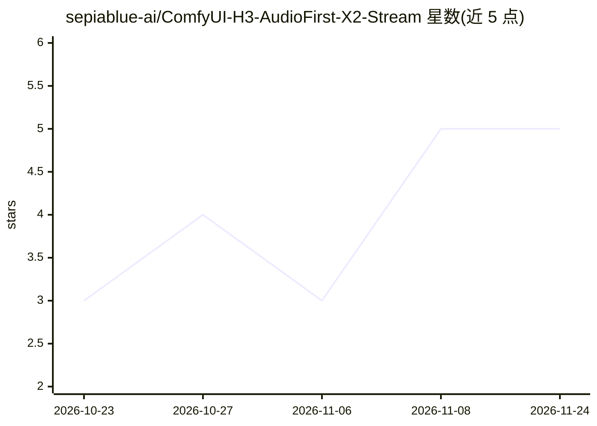

# sepiablue-ai/ComfyUI-H3-AudioFirst-X2-Stream

⭐ 5 · Python · GPL-3.0 · 推送 2026-10-22 · [GitHub](https://github.com/sepiablue-ai/ComfyUI-H3-AudioFirst-X2-Stream) · 个人维护 · 中文 README

**ComfyUI 节点包：音频优先两遍生成 MiniMax H3 视频**

面向 ComfyUI 用户的自定义节点包，为 MiniMax H3 图生视频提供音频优先两遍流程：先在 32×32 画布上以 8 步完成纯音频生成并锁定，再运行未改动的视频生成通道，输出 1088×1920 带音频视频（INT8 X2 VAE、H.264 NVENC、AAC）。提供标准、fast（LBH 3+1，需另装 ComfyUI-H3-LBH-X2-Stream）与 speed 三种模式；speed 模式最后一步跳过 50 个 DiT 块中的 10 个，画面细节比 fast 变体更软。要求 Windows 加 NVIDIA CUDA，经 ComfyUI-Manager 或 Windows 脚本安装。

## 筛选速览

| 维度 | 判定 | 备注 |
|---|---|---|
| AI 角色 | `ai-native` | 本体是模型或模型工具 |
| 许可风险 | `viral` | GPL-3.0 |
| 部署形态 | `desktop` | 安装包/桌面程序 |
| 模型依赖 | — | README 未给出锁定关系 |
| 硬件要求 | — | 无带数字的原话,不猜 |
| 安装摩擦 | `medium` | 含编译或系统依赖之一 |
| 成熟度 | — | 结构信号不足 |

## 能力要点

- 先在 32×32 画布完成音频生成并锁定，减少快模式下的金属感人声
- speed 模式最后一步跳过 10/50 个 DiT 块，在 RTX 4070 12GB 上 14 秒视频 99.8 s
- 音频锁校验：视频通道后音频 latent 不一致则中止保存
- 三种模式：标准（自由宽高比）、fast（LBH 3+1）、speed

## 适用场景

- 在 12GB 显存的 RTX 4070 上生成 1088×1920 带音频的对白/演唱视频
- 希望降低快设置下金属管道感人声的用户
- 在时间与画面细节之间按需选择三种模式

## 场景标签

`视频生成` · 领域:内容生成

## 证据(README 行号)

> L1: # ComfyUI H3 AudioFirst X2 Stream
> L54: The voice is finished first in an 8-step audio-only pass on a tiny 32 × 32 canvas, then locked while the unchanged 
> L141: ComfyUI must provide native MiniMax H3 (MiniMaxH3ImageToVideo, MiniMaxH3SigmaShift) and BlockSparseAttention. Meas

## 星数曲线

2026-10-23 3 → 2026-11-24 5（+2）

---
*卡片 v1 · prompt 1.4 · 生成 2026-11-22 · 置信度 high · 依据 README sha `c5fab5d4f260` · [字段定义](../../DATASET.md)*
