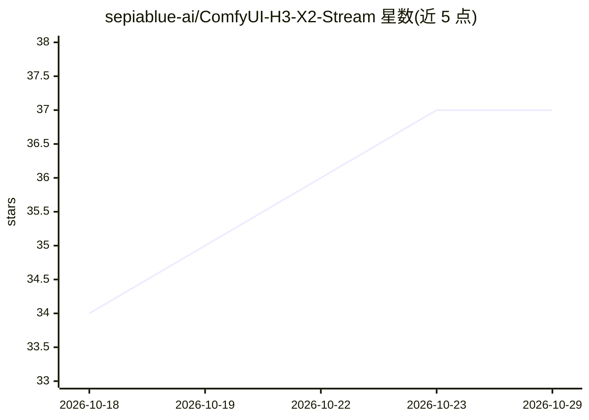

# sepiablue-ai/ComfyUI-H3-X2-Stream

⭐ 37 · Python · GPL-3.0 · 推送 2026-10-15 · [GitHub](https://github.com/sepiablue-ai/ComfyUI-H3-X2-Stream) · [官网](https://sayakabenchmark.pages.dev/) · 个人维护 · 中文 README

**加速 MiniMax H3 视频生成的 ComfyUI 自定义节点：INT8 X2 VAE + 异步 NVENC 保存**

面向 ComfyUI 用户的自定义节点包，包含三个节点：将 MiniMax H3 X2 Detail VAE 一次性转换为 INT8 并本地保存、解码时与 H.264 NVENC 编码重叠的流式保存节点、将 H3 FFN token 按 2048 分块的节点。附 4 步可直接加载的示例工作流。官方在 Windows + RTX 4070 12 GB 环境测试，1088×1920、124 帧带音频视频约 60 秒生成，较 FP16 X2 VAE 基线减少约 30% 耗时；AMD、Apple、CPU-only 与 Linux 未验证。权重不随附、需手动放置，转换在 ComfyUI 内执行。

## 筛选速览

| 维度 | 判定 | 备注 |
|---|---|---|
| AI 角色 | `ai-ecosystem` | LLM/agent 周边工具 |
| 许可风险 | `viral` | GPL-3.0 |
| 部署形态 | `desktop` | 安装包/桌面程序 |
| 模型依赖 | — | README 未给出锁定关系 |
| 硬件要求 | — | 无带数字的原话,不猜 |
| 安装摩擦 | `medium` | 含编译或系统依赖之一 |
| 成熟度 | `idea` | |

## 能力要点

- X2 Detail VAE 一次性 INT8 转换并复用本地转换文件
- 解码分块与 H.264 NVENC 编码重叠的异步流式保存（音频存为 AAC）
- H3 FFN token 自动 2048 分块（末尾小块合并）
- 保留 ComfyUI 原生 H3 空间/时间混合，不覆盖核心文件

## 适用场景

- 在低显存消费级 NVIDIA 显卡上生成 H3 视频
- 缩短 H3 视频的解码与保存耗时
- 用现成示例工作流快速跑通 4 步 FL2VA 生成

## 场景标签

`视频生成` `模型量化` · 领域:内容生成

## 证据(README 行号)

> L5: Prepare an INT8 version of the MiniMax H3 X2 Detail VAE inside ComfyUI, then decode and save video with a bounded as
> L27: |**H3 X2 Prepare INT8 VAE**|Converts the original X2 Detail v1 checkpoint once, saves it locally, and returns a usa
> L28: |**H3 X2 Decode + Stream Save**|Preserves ComfyUI's native H3 spatial/temporal blending, unpacks X2 RGB, and overla

## 星数曲线

2026-10-18 34 → 2026-10-29 37（+3）

---
*卡片 v1 · prompt 1.4 · 生成 2026-10-25 · 置信度 mid · 依据 README sha `8f388c2ec42c` · [字段定义](../../DATASET.md)*
