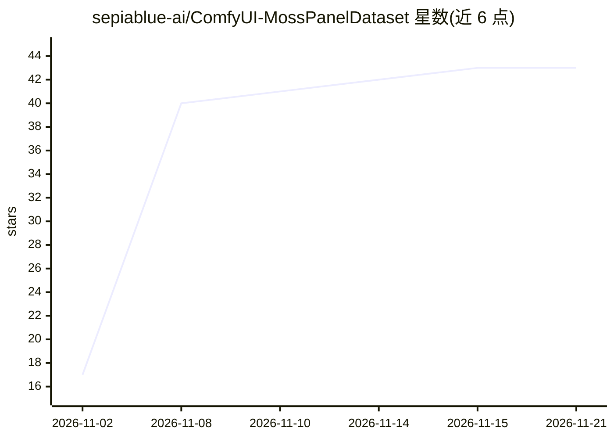

# sepiablue-ai/ComfyUI-MossPanelDataset

⭐ 43 · Python · MIT · 推送 2026-11-05 · [GitHub](https://github.com/sepiablue-ai/ComfyUI-MossPanelDataset) · 组织维护

**给 MOSS-Image 漫画创作者的 ComfyUI 自定义节点：从见本选分镜再填人物台词**

面向 ComfyUI 中使用 MOSS-Image 生成漫画的用户：内置 196 种 2-6 格分镜见本与 120 种 1-3 人构图见本，在 ComfyUI 界面里选择分镜并填写人物外见、场景、台词，由节点自动组装 MOSS 提示词，省去手工写 JSON 和坐标。支持最多 3 个共通人物、每格 3 人 3 发言，可从人物参考图像借助 MOSS 的 Qwen 文本编码器提取英文外见描述，无需额外模型。限制：不保证分格形状与文字准确，模型下载与环境配置由使用者负责。

## 筛选速览

| 维度 | 判定 | 备注 |
|---|---|---|
| AI 角色 | `ai-ecosystem` | LLM/agent 周边工具 |
| 许可风险 | `permissive` | MIT |
| 部署形态 | `None` |  |
| 模型依赖 | — | README 未给出锁定关系 |
| 硬件要求 | — | 无带数字的原话,不猜 |
| 安装摩擦 | `low` | 无编译、无系统依赖或容器化 |
| 成熟度 | — | 结构信号不足 |

## 能力要点

- 196 种 2-6 格分镜见本与 120 种构图见本随包内附，浏览无需外部服务
- 选择分镜后自动增减格输入节点并保留退避输入
- 复用 MOSS 文本编码器（Qwen）从人物图像提取英文外见描述，无需额外模型或包
- 支持检视/编辑实际传给 MOSS 的提示词的中间节点

## 适用场景

- 在 ComfyUI 里给 MOSS-Image 挑分镜、填人物和台词直接生成漫画页
- 只生成空分格线稿，之后再自己排版
- 从人物参考图提取英文外见描述再生成构图指定的漫画

## 场景标签

`图像生成` `提示工程` · 领域:Agent 开发

## 证据(README 行号)

> L5: ComfyUIの中で漫画のコマ割りを画像から選び、人物・場面・セリフを専用欄に入力してMOSSへ渡すカスタムノードです。配置ごとのワークフローのダウンロードや、JSON・座標の手書きは不要です。
> L31: 2. 下記のMOSS対応ComfyUIとモデルを用意してください。このノード専用の追加パッケージやインストールスクリプトはありません。
> L45: Python 3.10以降と、MOSS-Imageのネイティブ対応を含むComfyUIが必要です。動作確認はComfyUI v0.42.0（Python 3.13）で行いました。`CLIPLoader` の種類に `moss_im

## 星数曲线

2026-11-02 17 → 2026-11-21 43（+26）

---
*卡片 v1 · prompt 1.4 · 生成 2026-11-18 · 置信度 high · 依据 README sha `cf759bffbfca` · [字段定义](../../DATASET.md)*
