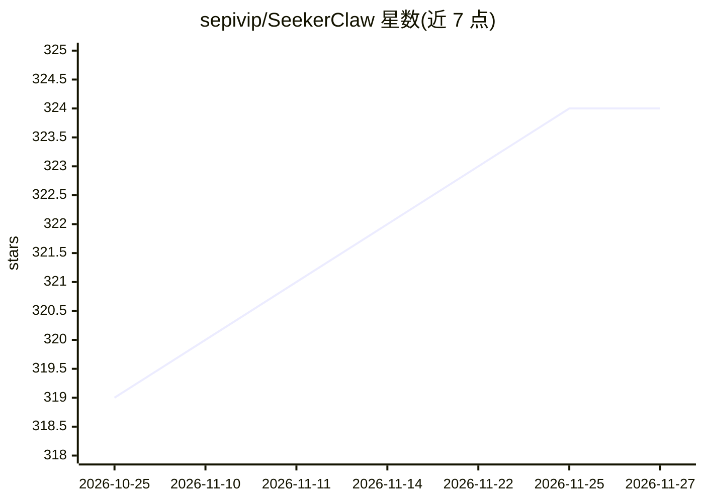

# sepivip/SeekerClaw

⭐ 324 · JavaScript · MIT · 推送 2026-11-26 · [GitHub](https://github.com/sepivip/SeekerClaw) · [官网](https://seekerclaw.xyz) · 个人维护

**把 Solana Seeker 或安卓手机变成 24/7 个人 AI agent**

在 Android 应用内嵌入 Node.js 运行时（nodejs-mobile），以前台服务形式 24/7 运行个人 AI agent，通过 Telegram 或 Discord 交互。内置 64 个工具与 22 个捆绑技能，支持 MCP 远程工具扩展；多供应商接入（Claude、OpenAI、xAI Grok、OpenRouter 及 OpenAI 兼容网关）。v2 起加入双钱包机制：应用内 burner 钱包在用户设定的单笔/日上限内自主交易与 x402 API 支付，主钱包始终由用户签名确认。需 Android Studio 与 JDK 17 从源码构建 APK。

## 筛选速览

| 维度 | 判定 | 备注 |
|---|---|---|
| AI 角色 | `ai-native` | 本体是模型或模型工具 |
| 许可风险 | `permissive` | MIT |
| 部署形态 | `None` |  |
| 模型依赖 | local-ok | 支持本地模型 |
| 硬件要求 | — | 无带数字的原话,不猜 |
| 安装摩擦 | `medium` | 含编译或系统依赖之一 |
| 成熟度 | `idea` | |

## 能力要点

- 内嵌 Node.js 前台服务，agent 24/7 运行于设备本地
- 64 个内置工具 + 22 个捆绑技能 + MCP 远程工具扩展
- burner 钱包在上限内自主交易与 x402 支付（AES-256-GCM 加密，可一键清除）
- Telegram/Discord 双通道，支持自然语言定时任务与持久记忆

## 适用场景

- 用聊天软件远程控制手机功能与安排任务
- 在设定上限内让 agent 自主进行 Solana 代币交易与 DCA
- 按次付费调用市场数据、旅行等 x402 付费 API
- 接入智能家居等第三方技能扩展 agent 能力

## 场景标签

`AI 助手` `金融量化` · 领域:对话与助手

## 证据(README 行号)

> L28: SeekerClaw — winner of the **Solana Mobile Hackathon (April 2026)** — embeds a Node.js AI agent inside an Android a
> L34: **64 built-in tools** (plus MCP remote tools), **22 bundled skills + 5 partner skills**, two-wallet Solana with **c
> L48: |:robot:|**AI Engine**|Claude (API key or Pro/Max setup token), OpenAI (API key or ChatGPT sign-in), xAI Grok (API 

## 星数曲线

2026-10-25 319 → 2026-11-27 324（+5）

---
*卡片 v1 · prompt 1.4 · 生成 2026-11-25 · 置信度 high · 依据 README sha `9ebe00012c10` · [字段定义](../../DATASET.md)*
