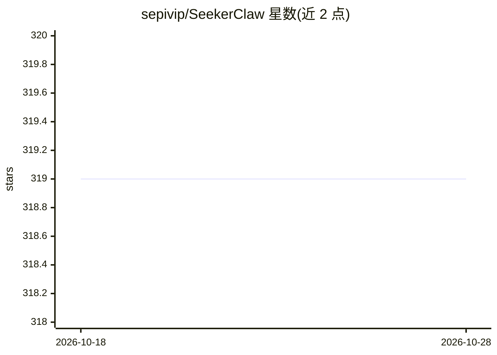

# sepivip/SeekerClaw

⭐ 319 · JavaScript · MIT · 推送 2026-10-28 · [GitHub](https://github.com/sepivip/SeekerClaw) · [官网](https://seekerclaw.xyz) · 个人维护

**把 Android 手机变成 24/7 常驻的个人 AI 代理应用**

Solana Mobile Hackathon 获奖项目：在 Android 应用内嵌 Node.js 运行时（前台服务），通过 Telegram/Discord 对话驱动 64 个内置工具与 MCP 远程工具，支持 Claude/OpenAI/OpenRouter/自定义网关多供应商。特色是双钱包 Solana 限额自治交易（swap/SPL 转账/限价/DCA）与 x402 自主 USDC 付费 API 调用（44 个编目端点、10 个服务），burner 密钥经 Android Keystore AES-256-GCM 加密、限额内静默签名。需 Android 14+，从源码用 Gradle 构建 APK；README 自述为 Beta 阶段。

## 筛选速览

| 维度 | 判定 | 备注 |
|---|---|---|
| AI 角色 | `ai-native` | 本体是模型或模型工具 |
| 许可风险 | `permissive` | MIT |
| 部署形态 | `None` |  |
| 模型依赖 | locked-api |  |
| 硬件要求 | — | 无带数字的原话,不猜 |
| 安装摩擦 | `medium` | 含编译或系统依赖之一 |
| 成熟度 | `idea` | |

## 能力要点

- Telegram/Discord 对话控制，64 内置工具 + MCP 远程工具
- 双钱包限额自治交易与 x402 USDC 自主付费（OPT-IN）
- 多供应商 AI（Claude/OpenAI/OpenRouter/自定义网关），扩展思考跨工具调用保留
- 35+ 伙伴技能 + 22 内置技能，技能为 Markdown+YAML 格式

## 适用场景

- 用 Telegram 对话让 AI 代管手机功能与日程
- 在限额内让代理自主执行 Solana 交易
- 让代理按需付费调用市场数据、旅行、研究等 x402 API

## 场景标签

`AI 助手` · 领域:对话与助手

## 证据(README 行号)

> L24: SeekerClaw — winner of the **Solana Mobile Hackathon (April 2026)** — embeds a Node.js AI agent inside an Android a
> L42: |:robot:|**AI Engine**|Claude, OpenAI (API key + Codex OAuth), OpenRouter, or any OpenAI-compatible gateway (Custom

## 星数曲线

2026-10-18 319 → 2026-10-28 319（+0）

---
*卡片 v1 · prompt 1.4 · 生成 2026-10-21 · 置信度 high · 依据 README sha `ee6105314f12` · [字段定义](../../DATASET.md)*
