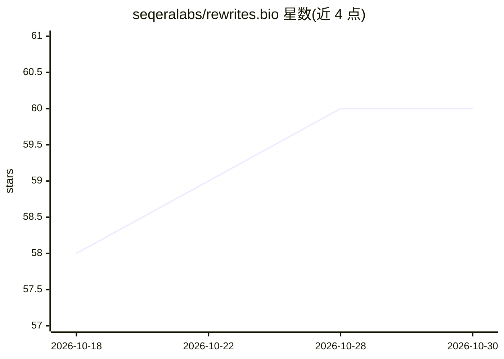

# seqeralabs/rewrites.bio

⭐ 60 · Astro · MIT · 推送 2026-10-26 · [GitHub](https://github.com/seqeralabs/rewrites.bio) · [官网](https://rewrites.bio) · 组织维护

**生物信息软件 AI 辅助现代化改造的宣言站点**

由 Seqera Labs 维护的宣言类网站（rewrites.bio），阐述以 AI 辅助方式对生物信息学软件进行现代化改造（如重写以提升速度与效率）的主张。站点基于 Astro 构建，构建时将渲染的 HTML 转换为适合 LLM 消费的 markdown 产物（manifesto.md、llms-full.txt、llms.txt、agent.md），并部署于 Netlify。仓库本身不包含模型或代码工具，仅承载宣言内容与站点源码。

## 筛选速览

| 维度 | 判定 | 备注 |
|---|---|---|
| AI 角色 | `ai-knowledge` | 知识聚合/清单类 |
| 许可风险 | `permissive` | MIT |
| 部署形态 | `library` | 以包/库形式分发 |
| 模型依赖 | — | README 未给出锁定关系 |
| 硬件要求 | — | 无带数字的原话,不猜 |
| 安装摩擦 | `low` | 无编译、无系统依赖或容器化 |
| 成熟度 | — | 结构信号不足 |

## 能力要点

- 宣言内容存于 Astro 源文件，构建为静态站点
- 构建后自动生成 LLM 友好产物（manifesto.md / llms.txt / agent.md）
- Netlify 部署，MIT 许可

## 适用场景

- 阅读生物信息软件现代化改造的主张与方向
- 以 LLM 友好格式（llms.txt 等）抓取宣言内容供 AI 工具消费

## 场景标签

 · 领域:生物信息/知识传播

## 证据(README 行号)

> L5: A manifesto for AI-assisted modernisation of bioinformatics software.
> L24: All manifesto content lives in the Astro source files (`src/pages/index.astro` and components). At build time, a po

## 星数曲线

2026-10-18 58 → 2026-10-30 60（+2）

---
*卡片 v1 · prompt 1.4 · 生成 2026-10-24 · 置信度 mid · 依据 README sha `adfc538cd4b6` · [字段定义](../../DATASET.md)*
