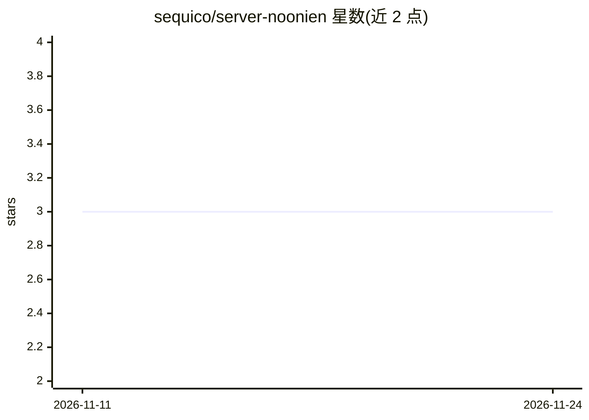

# sequico/server-noonien

⭐ — · [GitHub]() · 个人维护

**多机共享的 MCP 记忆知识图谱服务器：让 AI agent 记忆跨机器同步**

官方 @modelcontextprotocol/server-memory 的 drop-in 替代：保留相同的九个 MCP 工具（实体、观察、关系），另加 update_*、merge_entities、read_conflicts 扩展。核心机制是将图谱实现为 LWW-Element-Set CRDT，每台机器只写自己的 append-only shard（<node>.jsonl），由 nooniend 守护进程经 VPN/LAN 点对点复制合并，或经 file/S3 共享区传输，无需中心服务器与数据库，支持离线工作与网络恢复后重新收敛。提供 npm 包（Node ≥22）内含 MCP 服务器、维护 CLI 与复制守护进程三个命令，支持从官方 memory JSONL 导入迁移。

## 筛选速览

| 维度 | 判定 | 备注 |
|---|---|---|
| AI 角色 | `ai-ecosystem` | LLM/agent 周边工具 |
| 许可风险 | `permissive` | — |
| 部署形态 | `library` | 以包/库形式分发 |
| 模型依赖 | — | README 未给出锁定关系 |
| 硬件要求 | — | 无带数字的原话,不猜 |
| 安装摩擦 | `low` | 无编译、无系统依赖或容器化 |
| 成熟度 | — | 结构信号不足 |

## 能力要点

- 图谱为 LWW-Element-Set CRDT，合并幂等、可交换、可收敛，无 last-write-wins 丢数据
- nooniend 守护进程点对点复制 shard，无需共享文件夹与中心服务
- 与官方 memory server 九个工具完全 drop-in 兼容，另加三个扩展工具
- 维护 CLI 支持 import/export/merge/compact/query/stats/doctor

## 适用场景

- 多台机器上的 AI agent 共享同一份记忆知识图谱
- 替换现有 MCP memory server 而不改动 agent 配置
- 离线环境下本地读写记忆，联网后自动同步收敛
- 从官方单机 memory JSONL 文件迁移到多机部署

## 场景标签

`Agent 记忆` `知识图谱` · 领域:Agent 开发

## 证据(README 行号)

> L16: `server-noonien` is a drop-in replacement for the official
> L61: - **Drop-in for the official server.** The same nine tools, inputs and outputs, so it slots under
> L103: |**`server-noonien`**|the MCP memory server|short-lived, **spawned by the MCP client** over stdio|

## 星数曲线

2026-11-11 3 → 2026-11-24 3（+0）

---
*卡片 v1 · prompt 1.4 · 生成 2026-11-21 · 置信度 high · 依据 README sha `5d67293cc16a` · [字段定义](../../DATASET.md)*
