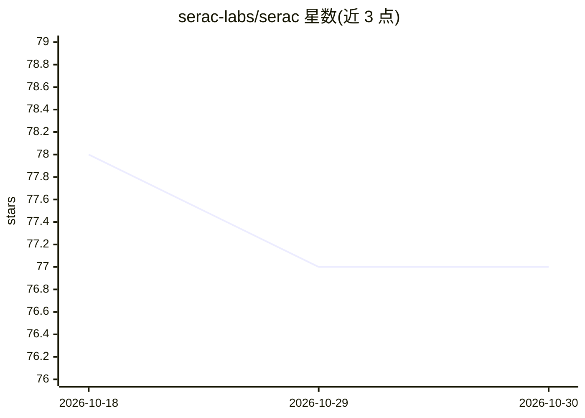

# serac-labs/serac

⭐ 77 · TypeScript · Apache-2.0 · 推送 2026-10-20 · [GitHub](https://github.com/serac-labs/serac) · [官网](https://serac.build) · 组织维护

**面向 ServiceNow 的 MCP 服务器与配套 agent 技能指南**

由 serac-labs 维护的双包仓库：`@serac-labs/servicenow-mcp` 提供 400+ 个 snow_* 工具（stdio 或 streamable HTTP），默认延迟加载目录以适配上下文窗口，附带影响面分析与诊断工具（snow_diagnose_setup）；`@serac-labs/skills` 提供 57 个 SKILL.md 格式的 ServiceNow 实践指南供 agent 加载。兼容任意 MCP 客户端，可通过 npm 全局安装或作为 Claude Code 插件安装。凭据来自实例上的 OAuth 应用注册条目；开发贡献需 Bun 1.3.14。仓库前身为 opencode 的分支，原 CLI 已停止维护。

## 筛选速览

| 维度 | 判定 | 备注 |
|---|---|---|
| AI 角色 | `ai-ecosystem` | LLM/agent 周边工具 |
| 许可风险 | `permissive` | Apache-2.0 |
| 部署形态 | `library` | 以包/库形式分发 |
| 模型依赖 | — | README 未给出锁定关系 |
| 硬件要求 | — | 无带数字的原话,不猜 |
| 安装摩擦 | `low` | 无编译、无系统依赖或容器化 |
| 成熟度 | — | 结构信号不足 |

## 能力要点

- 400+ snow_* 工具，默认延迟加载（tool_search/tool_execute 元工具）以适配上下文窗口
- 57 个 SKILL.md 技能指南，教 agent 以实践者方式使用工具
- snow_diagnose_setup / --doctor 诊断凭据、实例状态与角色
- 任意 MCP 客户端可用，提供 Claude Code 插件市场一键安装

## 适用场景

- 让 AI agent 在 ServiceNow 实例上执行运维与开发操作
- 为 MCP 客户端（Claude Code/Cursor/Windsurf/VS Code）接入 ServiceNow 工具
- 通过技能指南让 agent 掌握 ServiceNow 实践规范

## 场景标签

 · 领域:企业 IT 服务管理 / MCP 工具服务

## 证据(README 行号)

> L10:  A ServiceNow MCP server, and the skill guides that teach an agent to use it.
> L20: |`@serac-labs/servicenow-mcp`|An MCP server for ServiceNow. 400+ `snow_*` tools over stdio or streamable HTTP, plus
> L27: Both work with any MCP client. Neither requires the Serac product.

## 星数曲线

2026-10-18 78 → 2026-10-30 77（-1）

---
*卡片 v1 · prompt 1.4 · 生成 2026-10-24 · 置信度 high · 依据 README sha `5a953ea00571` · [字段定义](../../DATASET.md)*
