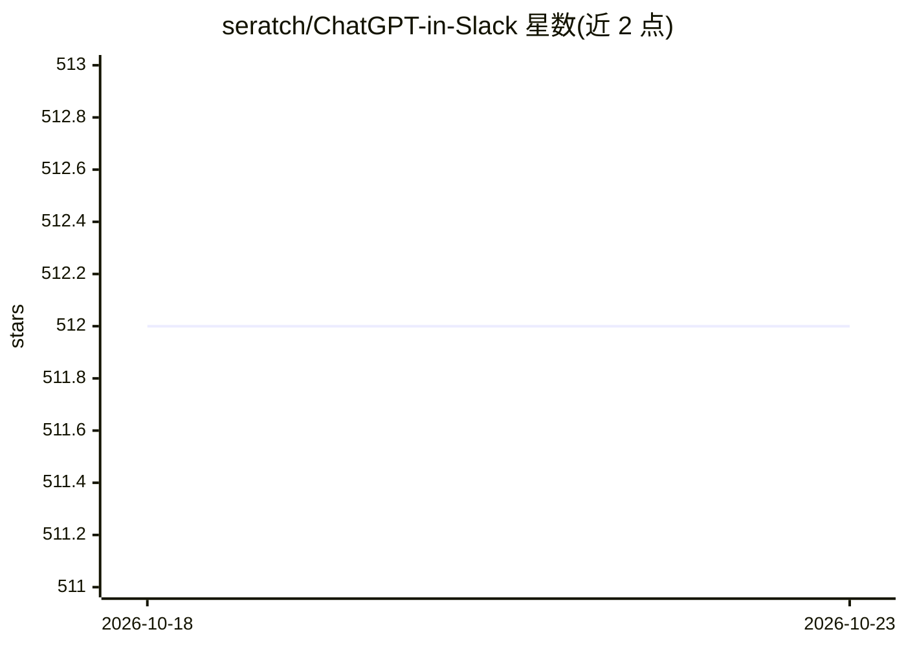

# seratch/ChatGPT-in-Slack

⭐ 512 · Python · MIT · 推送 2026-10-05 · [GitHub](https://github.com/seratch/ChatGPT-in-Slack) · 个人维护

**在 Slack 中接入 ChatGPT 机器人的开源示例应用**

基于 Python 的 Slack 应用，将 ChatGPT 以机器人形式接入 Slack 工作区：支持频道线程、1:1 私信、Home 标签页三种交互界面，线程内保持上下文记忆，Home 标签页可配置 OpenAI API key 与模型，提供快速校对与自由提示对话框，并支持通过 DALL-E 3 生成图片。本地运行需创建 Slack 应用并配置 OpenAI API key 等环境变量；企业工作区可用根目录 Dockerfile 自行部署，通过 Socket Mode 的 WebSocket 连接 Slack，无需公开 URL。作者另提供官方替代入口与下一代平台示例的指引。

## 筛选速览

| 维度 | 判定 | 备注 |
|---|---|---|
| AI 角色 | `ai-native` | 本体是模型或模型工具 |
| 许可风险 | `permissive` | MIT |
| 部署形态 | `self-host` | docker 或自建部署 |
| 模型依赖 | — | README 未给出锁定关系 |
| 硬件要求 | — | 无带数字的原话,不猜 |
| 安装摩擦 | `low` | 无编译、无系统依赖或容器化 |
| 成熟度 | — | 结构信号不足 |

## 能力要点

- 频道线程、1:1 DM、Home 标签页三种交互界面
- 线程内保持对话上下文记忆
- 支持 DALL-E 3 文生图与 Home 标签页快速校对
- 提供 Dockerfile，经 Socket Mode WebSocket 连接 Slack，无需公开 URL

## 适用场景

- 在 Slack 工作区内直接与 ChatGPT 对话完成写作与规划
- 团队在频道线程中共享 AI 对话
- 企业将应用部署到自有基础设施以保障信息保密

## 场景标签

`聊天机器人` `图像生成` · 领域:对话与助手

## 证据(README 行号)

> L5: Introducing a transformative app for Slack users, specifically designed to enhance your communication with ChatGPT!
> L30: 1. Talk to the bot in a channel thread

## 星数曲线

2026-10-18 512 → 2026-10-23 512（+0）

---
*卡片 v1 · prompt 1.4 · 生成 2026-10-21 · 置信度 high · 依据 README sha `0acf01ea1292` · [字段定义](../../DATASET.md)*
