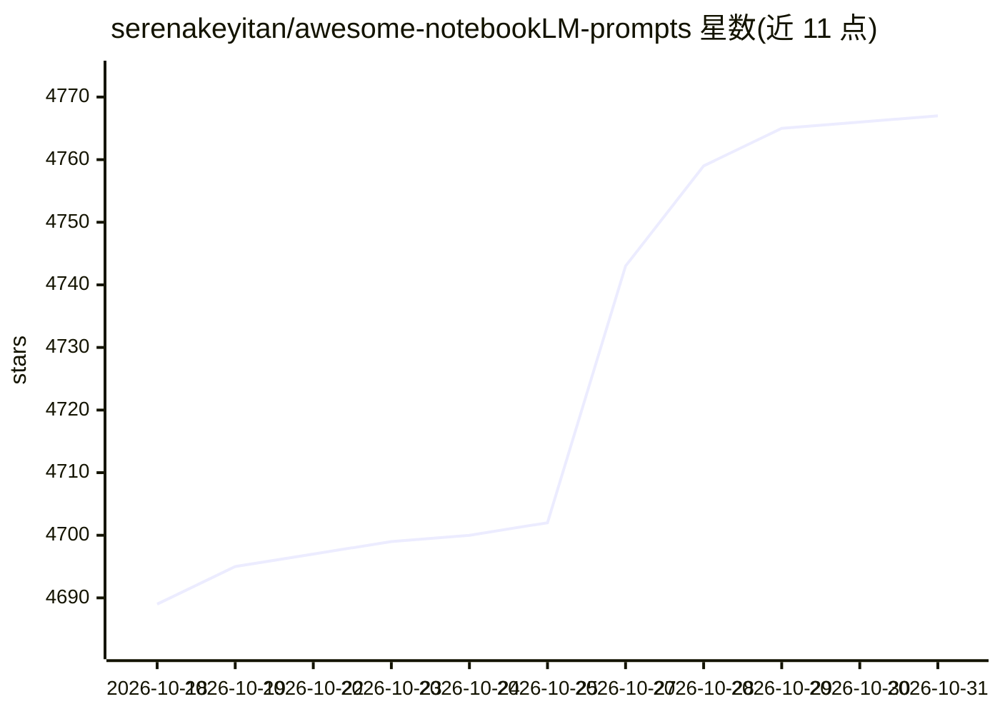

# serenakeyitan/awesome-notebookLM-prompts

⭐ 4,767 · MIT · 推送 2026-06-19 · [GitHub](https://github.com/serenakeyitan/awesome-notebookLM-prompts) · 个人维护

**NotebookLM 幻灯片提示词策展清单，按风格分类**

汇集来自 X/Twitter、Note、RED 等创作者社区经实际使用的 NotebookLM 及 Kael.im 幻灯片生成提示词，按报纸编辑、极简、漫画、杂志、街头、体育、霓虹科技等十余种视觉风格组织。每条条目附效果截图与原文来源链接，用于把论文、笔记、转录等材料转成演示幻灯片。仓库以 CC BY 4.0 许可，作者另提供引用检查技能说明与另一仓库链接。

## 筛选速览

| 维度 | 判定 | 备注 |
|---|---|---|
| AI 角色 | `ai-knowledge` | 知识聚合/清单类 |
| 许可风险 | `permissive` | MIT |
| 部署形态 | `None` |  |
| 模型依赖 | — | README 未给出锁定关系 |
| 硬件要求 | — | 无带数字的原话,不猜 |
| 安装摩擦 | `low` | 无编译、无系统依赖或容器化 |
| 成熟度 | — | 结构信号不足 |

## 能力要点

- 十余种风格类别的幻灯片生成提示词
- 每条附效果截图与创作者原文来源链接
- 提示词来源涵盖 X、Note、RED 等社区
- 附引用检查（检测幻觉引用）技能的说明

## 适用场景

- 为 NotebookLM 挑选不同视觉风格的幻灯片提示词
- 将论文、笔记、访谈转录整理为结构化演示文稿
- 参考创作者社区的幻灯片提示词写法并追溯来源

## 场景标签

`提示工程` `精选清单` · 领域:Agent 开发

## 证据(README 行号)

> L11: NotebookLM Slide Prompt⚡️
> L12: > A curated collection of the strongest NotebookLM & Kael.im slide prompts sourced from the real creative undergrou

## 星数曲线

2026-10-18 4,689 → 2026-10-31 4,767（+78）

---
*卡片 v1 · prompt 1.4 · 生成 2026-10-20 · 置信度 high · 依据 README sha `210601257a33` · [字段定义](../../DATASET.md)*
