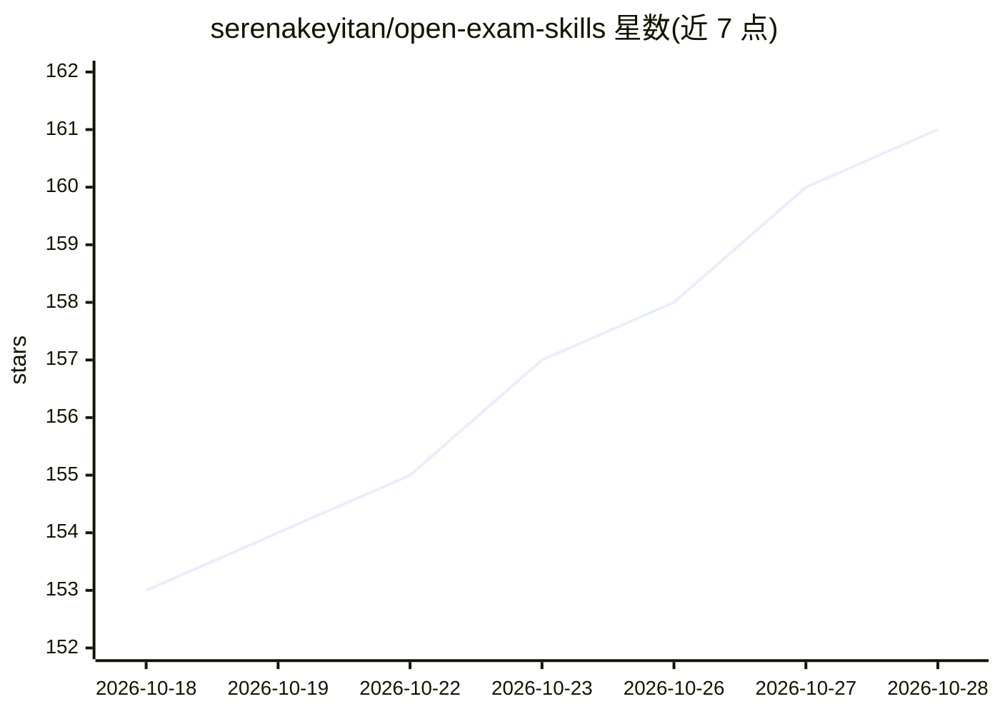

# serenakeyitan/open-exam-skills

⭐ 161 · Python · NOASSERTION · 推送 2026-02-02 · [GitHub](https://github.com/serenakeyitan/open-exam-skills) · [官网](https://kael.im/) · 个人维护

**面向学生与教师的学习技能集：思维导图/闪卡/测验/引用核查**

一组供 Claude、GPT 等 agent 平台使用的 SKILL 技能包，含思维导图（HTML/PNG/Mermaid）、闪卡（HTML/CSV）、带解析的练习测验、引用核查（无引用不输出）四个稳定技能，以及学生备考、练习考试、Trust Track 三类工作流组合。用户将 zip 上传至 Claude/GPT 的 Skills 设置，或在 Kael.im 内直接调用；也可 git clone 后用 install_all.sh 本地安装。稳定技能无需 API key，dev 分支另含音频/视频等实验技能。

## 筛选速览

| 维度 | 判定 | 备注 |
|---|---|---|
| AI 角色 | `ai-knowledge` | 知识聚合/清单类 |
| 许可风险 | `none` | NOASSERTION |
| 部署形态 | `desktop` | 安装包/桌面程序 |
| 模型依赖 | — | README 未给出锁定关系 |
| 硬件要求 | — | 无带数字的原话,不猜 |
| 安装摩擦 | `low` | 无编译、无系统依赖或容器化 |
| 成熟度 | — | 结构信号不足 |

## 能力要点

- 4 个稳定技能：mindmap/flashcards/quiz/citation-check
- 3 类学习工作流组合（学生备考/练习考试/Trust Track）
- citation-check 强制'无引用不输出'
- 稳定技能无需 API key，安装即用

## 适用场景

- 把课堂笔记转成思维导图、闪卡和练习题来备考
- 教师和助教用讲义快速生成测验与模拟题
- 核查报告或笔记中的论断是否有出处

## 场景标签

 · 领域:教育/agent 技能

## 证据(README 行号)

> L7: You can upload these skills and run them directly inside Claude and GPT, or run them in Kael by simply saying things
> L49: ## Skills Table
> L66: 3. Upload the zip into Claude or GPT (Settings → Skills → Add).

## 星数曲线

2026-10-18 153 → 2026-10-28 161（+8）

---
*卡片 v1 · prompt 1.4 · 生成 2026-10-22 · 置信度 high · 依据 README sha `a2571b4a4912` · [字段定义](../../DATASET.md)*
