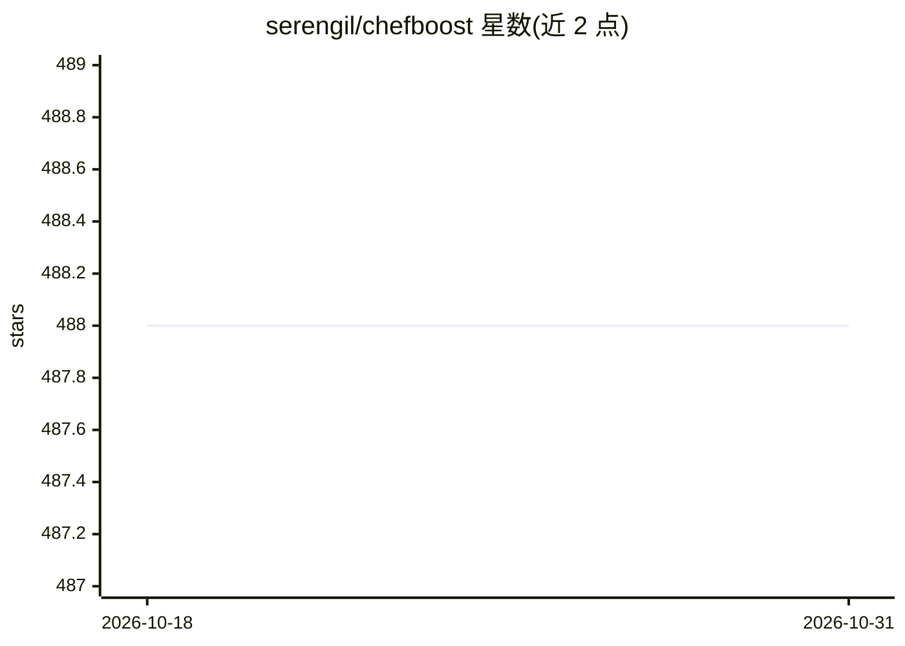

# serengil/chefboost

⭐ 488 · Python · MIT · 推送 2026-05-13 · [GitHub](https://github.com/serengil/chefboost) · [官网](https://www.youtube.com/watch?v=Z93qE5eb6eg&list=PLsS_1RYmYQQHp_xZObt76dpacY543GrJD&index=3) · 个人维护

**轻量级 Python 决策树框架，支持 ID3/C4.5/CART/CHAID 及集成方法**

面向 Python 数据科学使用者的决策树框架：以 pandas DataFrame 为输入，无需预处理即可处理数值与类别型特征和目标值；内置 ID3、C4.5、CART、CHAID、回归树五种常规算法，以及梯度提升、随机森林、Adaboost 三种集成技术。训练产出的树以 Python if 语句形式存储，可脱离训练环境直接调用或恢复用于迁移学习；支持模型保存加载、特征重要性计算与多核并行建树（默认启用，分配一半核心）。

## 筛选速览

| 维度 | 判定 | 备注 |
|---|---|---|
| AI 角色 | `ai-native` | 本体是模型或模型工具 |
| 许可风险 | `permissive` | MIT |
| 部署形态 | `library` | 以包/库形式分发 |
| 模型依赖 | — | README 未给出锁定关系 |
| 硬件要求 | — | 无带数字的原话,不猜 |
| 安装摩擦 | `low` | 无编译、无系统依赖或容器化 |
| 成熟度 | — | 结构信号不足 |

## 能力要点

- 原生支持类别型特征与目标值，无需预处理
- 覆盖 ID3/C4.5/CART/CHAID/回归树及 GBM/随机森林/Adaboost
- 决策树以 Python if 语句输出，可恢复复用与迁移学习
- 支持多核并行建树与特征重要性计算

## 适用场景

- 用少量代码构建可解释的决策树模型
- 需要类别型特征直接建模的数据挖掘任务
- 将训练好的树导出为 Python 规则在生产端复用

## 场景标签

 · 领域:机器学习/数据挖掘

## 证据(README 行号)

> L10: **ChefBoost** is a lightweight decision tree framework for Python **with categorical feature support**. It covers r
> L35: model = chef.fit(df, config = config, target_label = 'Decision')

## 星数曲线

2026-10-18 488 → 2026-10-31 488（+0）

---
*卡片 v1 · prompt 1.4 · 生成 2026-10-21 · 置信度 high · 依据 README sha `d0b890ccec1c` · [字段定义](../../DATASET.md)*
