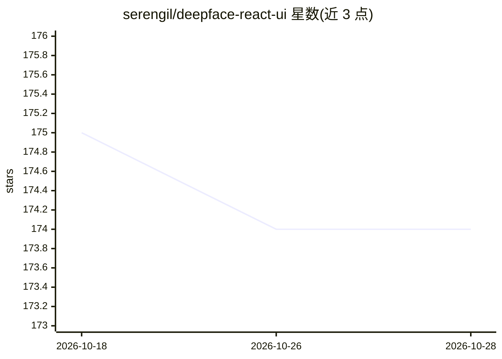

# serengil/deepface-react-ui

⭐ 174 · JavaScript · MIT · 推送 2026-05-13 · [GitHub](https://github.com/serengil/deepface-react-ui) · [官网](https://www.youtube.com/watch?v=WnUVYQP4h44&list=PLsS_1RYmYQQFdWqxQggXHynP1rqaYXv_E&index=1) · 个人维护

**基于 ReactJS 的人脸识别与属性分析 Web 界面**

用 ReactJS 构建的人脸识别前端界面，调用 DeepFace 库实现人脸验证、年龄/性别/情绪/种族预测，并带反欺诈（anti-spoofing）能力。用户通过 .env 配置 base64 人脸库与可选的识别模型、检测器（VGG-Face、Facenet、ArcFace、RetinaFace 等），浏览器授权摄像头后点击 Verify 在当前帧中检索身份。需与 deepface 仓库同目录克隆，分别启动服务，或用 Docker Compose 一键运行。面向在 Web 应用中加入人脸识别的开发者与研究者。

## 筛选速览

| 维度 | 判定 | 备注 |
|---|---|---|
| AI 角色 | `ai-native` | 本体是模型或模型工具 |
| 许可风险 | `permissive` | MIT |
| 部署形态 | `self-host` | docker 或自建部署 |
| 模型依赖 | — | README 未给出锁定关系 |
| 硬件要求 | — | 无带数字的原话,不猜 |
| 安装摩擦 | `low` | 无编译、无系统依赖或容器化 |
| 成熟度 | — | 结构信号不足 |

## 能力要点

- 人脸验证与年龄/性别/情绪/种族属性分析
- 内置 anti-spoofing 反欺诈能力
- 可选 10 种识别模型与 10 种人脸检测器（.env 配置）
- 支持 Docker Compose 一键部署

## 适用场景

- 在 Web 应用中做基于摄像头的人脸身份验证
- 研究/演示不同识别模型与检测器的组合效果
- 构建带人脸识别的安全或个性化应用原型

## 场景标签

`人脸识别` · 领域:感知与多模态

## 证据(README 行号)

> L7: deepface-react-ui is a comprehensive user interface for facial recognition and facial attribute analysis (age, gende
> L86: UI also supports demography analysis including age, gender, emotion and race & ethnicity prediction tasks.

## 星数曲线

2026-10-18 175 → 2026-10-28 174（-1）

---
*卡片 v1 · prompt 1.4 · 生成 2026-10-22 · 置信度 high · 依据 README sha `43919de38494` · [字段定义](../../DATASET.md)*
