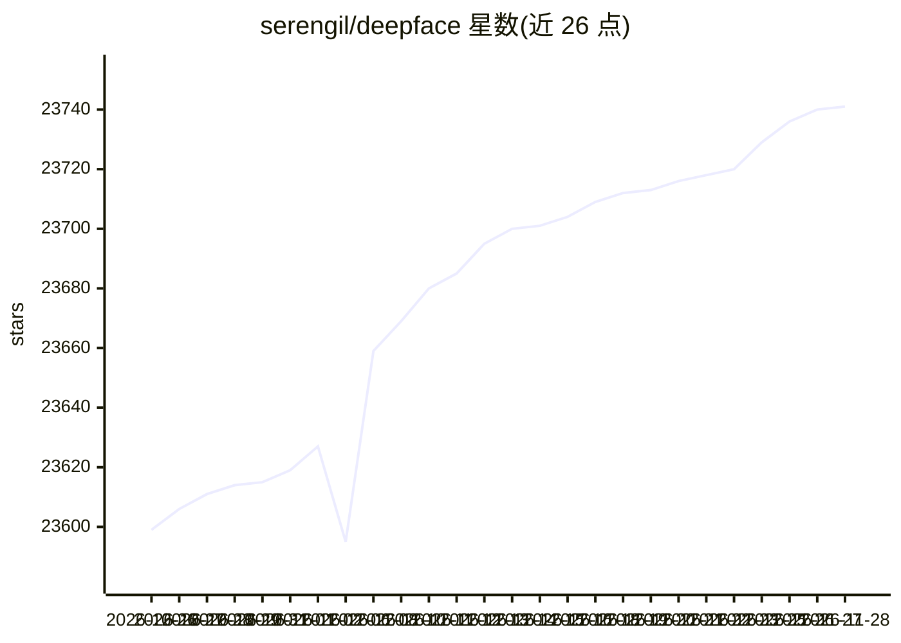

# serengil/deepface

⭐ 23,741 · Python · MIT · 推送 2026-11-20 · [GitHub](https://github.com/serengil/deepface) · [官网](https://www.youtube.com/watch?v=WnUVYQP4h44&list=PLsS_1RYmYQQFdWqxQggXHynP1rqaYXv_E) · 个人维护

**Python 人脸识别与年龄/性别/表情/种族分析库**

混合式人脸识别与 facial attribute 分析框架，封装 VGG-Face、FaceNet、ArcFace、Buffalo_L 等模型，覆盖检测、对齐、表示、验证的完整流水线。用户调用单行函数即可完成人脸验证、1:N 查找、属性分析（年龄、性别、表情、种族）、嵌入向量提取与反欺骗检测；支持数据库后端的人脸检索（pgvector、milvus 等），并可运行实时视频流。提供 REST/gRPC API 与 Docker 部署方式，默认基于 ONNX Runtime 运行。

## 筛选速览

| 维度 | 判定 | 备注 |
|---|---|---|
| AI 角色 | `ai-native` | 本体是模型或模型工具 |
| 许可风险 | `permissive` | MIT |
| 部署形态 | `library` | 以包/库形式分发 |
| 模型依赖 | — | README 未给出锁定关系 |
| 硬件要求 | — | 无带数字的原话,不猜 |
| 安装摩擦 | `low` | 无编译、无系统依赖或容器化 |
| 成熟度 | — | 结构信号不足 |

## 动量与使用信号

- 维护:`active` — 距上次 push 0.9 天,年发版 7,94 位贡献者
- 涨星:近 1 天 **+9**(自 20261016 起算)
- 安装:pypi 包 `deepface` 月下载 74,752
- 平台:— · 协议:MCP

## 能力要点

- 封装 10 个人脸识别模型与 9 种检测/对齐后端，可切换
- 单行调用验证、查找、分析、represent 等功能
- 支持 postgres/milvus/qdrant 等多种数据库后端的检索与 ANN
- 提供 REST API、gRPC API 与反欺骗模块

## 适用场景

- 判断两张人脸图片是否为同一人
- 在照片库或数据库中搜索人脸身份
- 从图片或摄像头视频流预测年龄、性别与表情
- 为移动或 Web 应用提供人脸识别 REST/gRPC 服务

## 场景标签

`人脸识别` · 领域:感知与多模态

## 证据(README 行号)

> L11: DeepFace is a lightweight face recognition and facial attribute analysis (age, gender, emotion and race) framework 
> L48: This function determines whether two facial images belong to the same person or to different individuals. The funct

## 星数曲线

2026-10-26 23,599 → 2026-11-28 23,741（+142）

---
*卡片 v1 · prompt 1.4 · 生成 2026-11-22 · 置信度 high · 依据 README sha `39e0e9b099de` · [字段定义](../../DATASET.md)*
