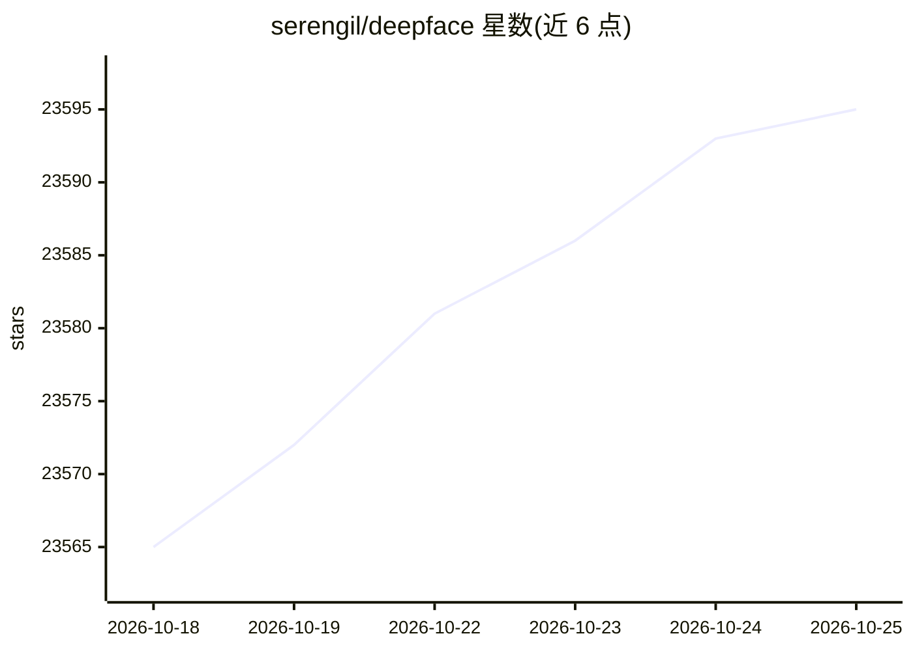

# serengil/deepface

⭐ 23,595 · Python · MIT · 推送 2026-10-24 · [GitHub](https://github.com/serengil/deepface) · [官网](https://www.youtube.com/watch?v=WnUVYQP4h44&list=PLsS_1RYmYQQFdWqxQggXHynP1rqaYXv_E) · 个人维护

**Python 人脸识别与人脸属性分析库，一行代码完成验证/检索/分析**

用于 Python 的人脸识别与人脸属性分析框架，封装 VGG-Face、FaceNet、ArcFace、Buffalo_L 等模型，后台完成检测、对齐、归一化、表示、验证五段流水线。提供验证（verify）、1:N 检索（find，支持 s3/ftp）、数据库后端注册与搜索（postgres、pgvector、milvus 等 15 种）、属性分析（年龄/性别/表情/种族）、嵌入向量提取、实时视频流、反欺骗检测；另带 REST/gRPC API 与 Docker 化脚本，并提供 deepface.dev 托管 API（含 MCP 端点）。MIT 许可，附 BibTeX 引用条目。

## 筛选速览

| 维度 | 判定 | 备注 |
|---|---|---|
| AI 角色 | `ai-native` | 本体是模型或模型工具 |
| 许可风险 | `permissive` | MIT |
| 部署形态 | `library` | 以包/库形式分发 |
| 模型依赖 | — | README 未给出锁定关系 |
| 硬件要求 | — | 无带数字的原话,不猜 |
| 安装摩擦 | `low` | 无编译、无系统依赖或容器化 |
| 成熟度 | — | 结构信号不足 |

## 动量与使用信号

- 维护:`active` — 距上次 push 0.9 天,年发版 7,94 位贡献者
- 涨星:近 1 天 **+9**(自 20261016 起算)
- 安装:pypi 包 `deepface` 月下载 74,752
- 平台:— · 协议:MCP

## 能力要点

- 封装 10 种人脸识别模型，支持验证、1:N 检索与嵌入向量提取
- 数据库后端人脸识别：支持 postgres、pgvector、milvus、qdrant 等 15 种后端及近似最近邻
- 年龄/性别/表情/种族属性分析与反欺骗（anti-spoofing）模块
- 提供 REST API、gRPC API 与 Docker 脚本，支持摄像头实时分析

## 适用场景

- 判断两张人脸图片是否为同一人
- 在图像库或数据库中检索输入人脸的身份
- 从图片或实时视频中预测年龄、性别、表情与种族
- 通过 API 把人脸识别能力接入移动端或 Web 应用

## 场景标签

`人脸识别` · 领域:感知与多模态

## 证据(README 行号)

> L11: DeepFace is a lightweight face recognition and facial attribute analysis (age, gender, emotion and race) framework 
> L13: A modern face recognition pipeline consists of 5 common stages: detect, align, normalize, represent and verify. Whi
> L62: DeepFace supports database-backed operations for scalable face recognition, allowing embeddings to be explicitly re

## 星数曲线

2026-10-18 23,565 → 2026-10-25 23,595（+30）

---
*卡片 v1 · prompt 1.4 · 生成 2026-10-18 · 置信度 high · 依据 README sha `bef30ade1672` · [字段定义](../../DATASET.md)*
