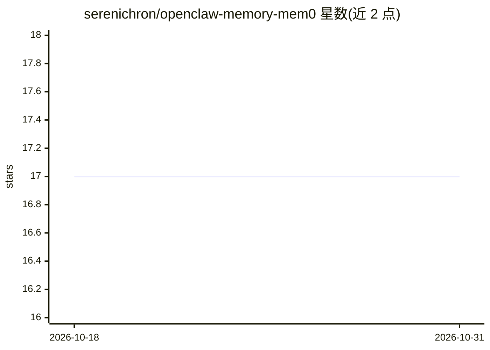

# serenichron/openclaw-memory-mem0

⭐ 17 · TypeScript · MIT · 推送 2026-05-21 · [GitHub](https://github.com/serenichron/openclaw-memory-mem0) · 个人维护

**OpenClaw 记忆插件：接入自托管 Mem0 提供长期记忆**

以 Node.js 实现的 OpenClaw 网关记忆插件，通过 REST API 调用自托管 Mem0 服务，替换默认 LanceDB 后端。提供 memory_recall/memory_store/memory_forget 三个 agent 工具，支持执行前自动注入相关记忆（auto-recall，按阈值过滤）与执行后自动存储对话要点（auto-capture）。零原生依赖，仅用 Node.js 内置 fetch。安装方式为复制到扩展目录并 npm install，需预先运行 Mem0 REST 服务（mem0ai 或兼容 HTTP 服务）。

## 筛选速览

| 维度 | 判定 | 备注 |
|---|---|---|
| AI 角色 | `ai-ecosystem` | LLM/agent 周边工具 |
| 许可风险 | `permissive` | MIT |
| 部署形态 | `library` | 以包/库形式分发 |
| 模型依赖 | — | README 未给出锁定关系 |
| 硬件要求 | — | 无带数字的原话,不猜 |
| 安装摩擦 | `low` | 无编译、无系统依赖或容器化 |
| 成熟度 | — | 结构信号不足 |

## 能力要点

- 三个 agent 工具与 openclaw mem0 search/list/forget CLI 命令
- before_agent_start 钩子按相关度阈值自动注入记忆
- agent_end 钩子自动提取并存储对话要点，跳过反馈循环
- 零原生依赖，仅用 Node.js 内置 fetch

## 适用场景

- 让 OpenClaw agent 具备基于 Mem0 的长期记忆
- 用任意 LLM 与嵌入模型组合自托管记忆后端
- 从 LanceDB 记忆后端切换并保留原配置可回退

## 场景标签

`Agent 记忆` · 领域:Agent 开发

## 证据(README 行号)

> L3: OpenClaw memory plugin backed by a self-hosted Mem0 REST API.
> L5: Replaces the default LanceDB memory backend with Mem0's semantic extraction pipeline — your agents get long-term mem
> L142: 1. Change `plugins.slots.memory` from `"memory-lancedb"` to `"memory-mem0"`

## 星数曲线

2026-10-18 17 → 2026-10-31 17（+0）

---
*卡片 v1 · prompt 1.4 · 生成 2026-10-29 · 置信度 high · 依据 README sha `3ce7dba05e7f` · [字段定义](../../DATASET.md)*
