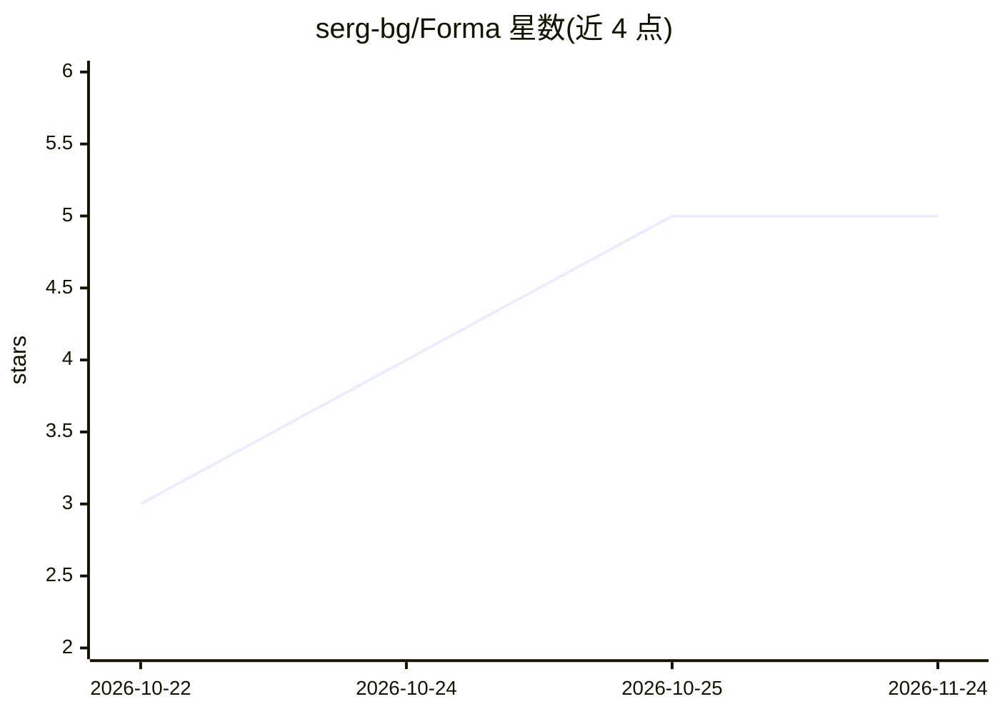

# serg-bg/Forma

⭐ 5 · GPL-3.0 · 推送 2026-11-12 · [GitHub](https://github.com/serg-bg/Forma) · 个人维护

**面向神经科学研究者的桌面端 3D 显微图像深度学习分割与分析应用**

Forma 是一个 Mac/Windows/Linux 桌面应用，工作流为：读取 TIFF/ND2/CZI 显微图像堆栈，转换为 OME-Zarr 存储，用 nnU-Net 深度学习模型做 3D 分割，量化分割对象，并在捆绑的 napari 中查看与修正。支持 Apple silicon 与 NVIDIA GPU 加速，也可在 CPU 运行。无 Python 环境要求，应用在首次使用时自行下载约 2 GB 分析工具与 1.1 GB 神经元形态分割模型（权重为 CC BY-NC 4.0 非商业许可）。超过模型尺寸上限的图像采用分块分割并支持断点续跑。

## 筛选速览

| 维度 | 判定 | 备注 |
|---|---|---|
| AI 角色 | `ai-native` | 本体是模型或模型工具 |
| 许可风险 | `dual` | GPL-3.0 |
| 部署形态 | `desktop` | 安装包/桌面程序 |
| 模型依赖 | — | README 未给出锁定关系 |
| 硬件要求 | — | 无带数字的原话,不猜 |
| 安装摩擦 | `low` | 无编译、无系统依赖或容器化 |
| 成熟度 | `idea` | |

## 能力要点

- TIFF/ND2/CZI 2D-5D 堆栈一次性转换为 OME-Zarr 多尺度存储
- nnU-Net 3D 分割引擎支持 Apple silicon GPU、NVIDIA GPU 或 CPU
- 捆绑 napari 与插件，修正后的标签保存为新修订版不覆盖原结果
- Lazy Tracer 插件在大体积中追踪神经元并导出 SWC 文件

## 适用场景

- 将 3D 共聚焦神经元图像堆栈分割为树突、棘、胞体、轴突并量化
- 在 Mac 上用 GPU 运行自己的 nnU-Net 打包模型做 3D 分割
- 在 napari 中手动修正分割结果并追踪神经元形态

## 场景标签

`目标检测` `科研工具` · 领域:学习与行业

## 证据(README 行号)

> L3: Forma is a desktop app for 3D microscopy analysis on Mac, Windows, and Linux, with GPU acceleration on Apple silicon
> L10: - **3D deep-learning segmentation on a Mac.** The nnU-Net engine runs on the GPU of an Apple silicon Mac, on an NVI

## 星数曲线

2026-10-22 3 → 2026-11-24 5（+2）

---
*卡片 v1 · prompt 1.4 · 生成 2026-11-21 · 置信度 high · 依据 README sha `32a7c59a5494` · [字段定义](../../DATASET.md)*
