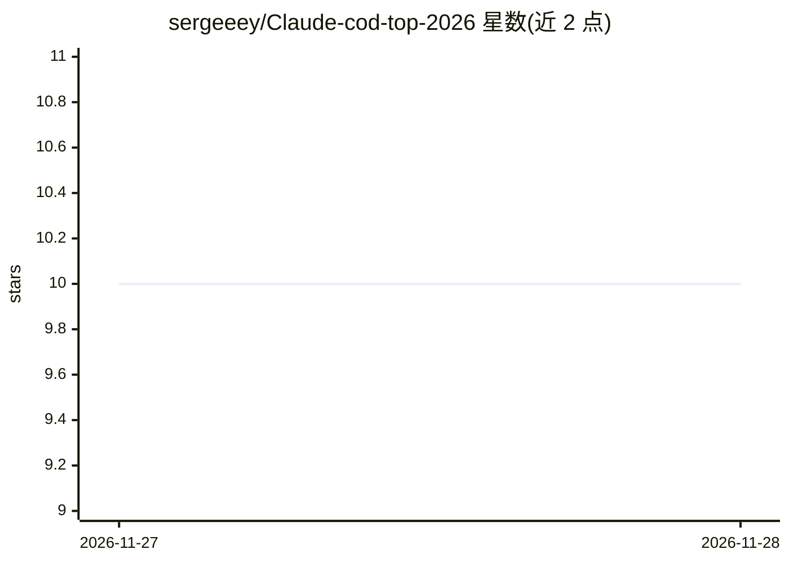

# sergeeey/Claude-cod-top-2026

⭐ 10 · Python · MIT · 推送 2026-11-27 · [GitHub](https://github.com/sergeeey/Claude-cod-top-2026) · [官网](https://github.com/sergeeey/Claude-cod-top-2026#readme) · 个人维护 · 中文 README

**为 Claude Code 加证据标记与审计门槛的开发配置层**

作为 Claude Code 的证据感知目标运行层：将目标转为可解释计划，组合技能、agent 与记忆，在受限自治预算内执行并验证结果。核心机制包括证据标记（[VERIFIED-REAL]/[VERIFIED-SYNTHETIC]）、Validation Theater 检测、103 个 Python hooks（仅 PreToolUse 可事前阻断，其余事后警告）、13 个 agent、PII 正则脱敏与 MCP 断路器。提供 minimal/standard/full 三档安装 profile；README 自述尚在早期阶段，仅验证于单人工作流，仅支持 Claude Code。

## 筛选速览

| 维度 | 判定 | 备注 |
|---|---|---|
| AI 角色 | `ai-ecosystem` | LLM/agent 周边工具 |
| 许可风险 | `permissive` | MIT |
| 部署形态 | `library` | 以包/库形式分发 |
| 模型依赖 | local-ok | 支持本地模型 |
| 硬件要求 | — | 无带数字的原话,不猜 |
| 安装摩擦 | `low` | 无编译、无系统依赖或容器化 |
| 成熟度 | `idea` | |

## 能力要点

- 证据标记机制区分真实数据与合成数据验证（synthetic ≠ real 硬规则）
- 103 个 Python hooks 覆盖 25 个事件，仅 PreToolUse 可事前阻断
- 12 类正则模式的 MCP 工具调用 PII 脱敏与 InputGuard 注入扫描
- 提供 minimal（3 文件）/standard/full 三档安装 profile 与无安装的纯规则路径

## 适用场景

- AI 辅助开发中拦截用合成数据自测自报成功的验证表演
- 处理敏感数据时在 MCP 工具调用前自动脱敏
- 为 Claude Code 会话配置权限策略与危险命令拦截
- 只需反幻觉规则时粘贴单文件到 CLAUDE.md

## 场景标签

`编码 Agent` · 领域:编码与开发

## 证据(README 行号)

> L55: Claude-cod-top-2026 is an **Evidence-aware Goal Operating Layer for Claude Code.**
> L148: - Built and tested for Claude Code **only** — Codex, VS Code Copilot and Gemini are not supported. per Cursor's do
> L185: - You need to **read every hook before installing** — only ~10 MB, plain Python, no JS dependencies, every file re

## 星数曲线

2026-11-27 10 → 2026-11-28 10（+0）

---
*卡片 v1 · prompt 1.4 · 生成 2026-11-27 · 置信度 mid · 依据 README sha `aa65caa5a920` · [字段定义](../../DATASET.md)*
