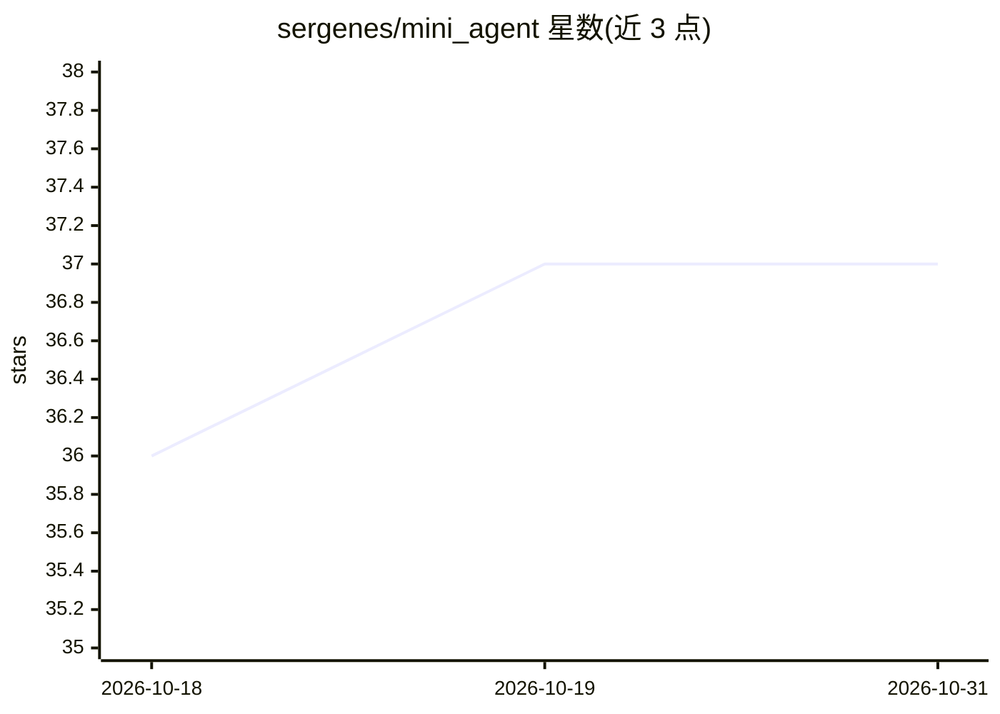

# sergenes/mini_agent

⭐ 37 · Python · 推送 2026-08-31 · [GitHub](https://github.com/sergenes/mini_agent) · 个人维护

**从零实现的极简 AI agent：纯 Python 循环加工具调用**

不依赖 agent 框架的教学型 AI agent：用 Python、OpenAI SDK 与 while 循环实现任务—工具调用—观察—循环的核心机制，支持 local（仅 Ollama 离线）、remote（OpenAI/Anthropic/Gemini 云端）、mixed（本地 Ollama 编排、复杂子任务委托远端）三种模式。附带可靠性层（指数退避重试、熔断、参数校验）、MCP client/server 示例、LLM 视觉测试工具（iOS/Android）与部署流水线。calculate 用 eval、部分工具为桩函数，面向想理解 agent 内部原理的开发者，配套 Medium 系列文章。

## 筛选速览

| 维度 | 判定 | 备注 |
|---|---|---|
| AI 角色 | `ai-native` | 本体是模型或模型工具 |
| 许可风险 | `none` | — |
| 部署形态 | `library` | 以包/库形式分发 |
| 模型依赖 | local-ok | 支持本地模型 |
| 硬件要求 | — | 无带数字的原话,不猜 |
| 安装摩擦 | `low` | 无编译、无系统依赖或容器化 |
| 成熟度 | — | 结构信号不足 |

## 能力要点

- 三种执行模式：local/remote/mixed（本地编排+远端委托）
- 可靠性层：重试、熔断器、pydantic 参数校验、provider 回退链
- 内置 MCP client/server，工具透明调用
- 附加 LLM 驱动的 iOS/Android 视觉 UI 测试与 CI/CD 部署工具

## 适用场景

- 学习不依赖框架的 agent 循环与工具调用实现
- 本地 Ollama 离线运行或混合编排远端模型
- 用 LLM 按视觉意图做移动端 UI 回归测试

## 场景标签

`Agent 框架` `教程课程` · 领域:Agent 开发

## 证据(README 行号)

> L3: A minimal AI agent built without any agent framework — just Python, the OpenAI SDK, and a `while` loop.
> L19: The agent takes a task, calls tools when needed, observes the results, and loops until it has a final answer. Three
> L23: |`local`|All LLM calls go to a local Ollama model — fully offline|

## 星数曲线

2026-10-18 36 → 2026-10-31 37（+1）

---
*卡片 v1 · prompt 1.4 · 生成 2026-10-25 · 置信度 mid · 依据 README sha `0f922c3876fb` · [字段定义](../../DATASET.md)*
