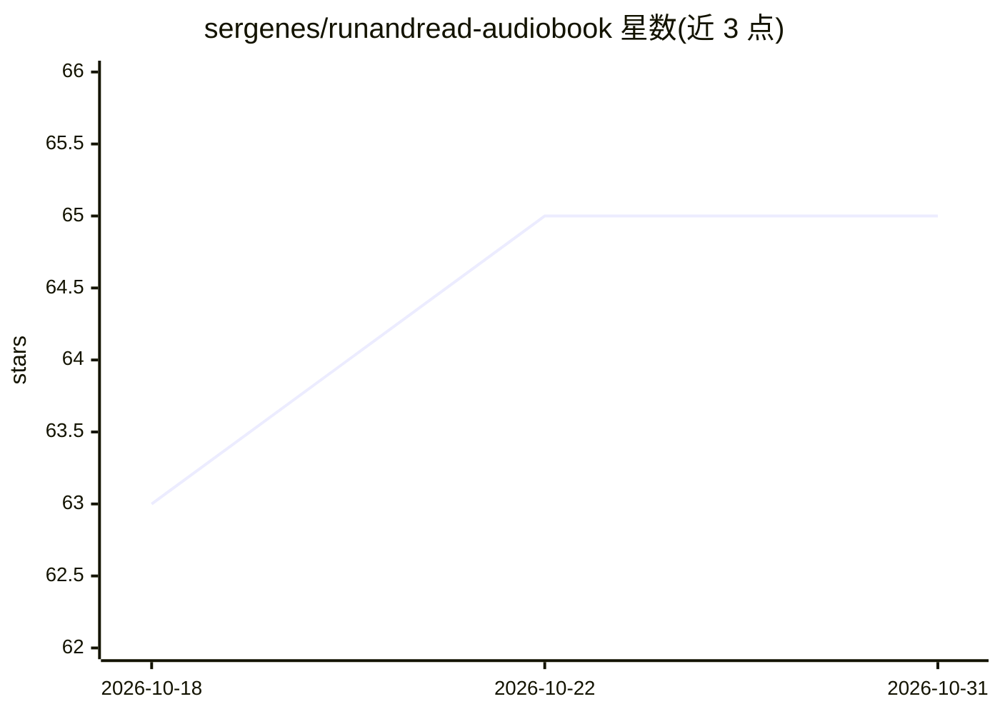

# sergenes/runandread-audiobook

⭐ 65 · Python · MIT · 推送 2026-08-17 · [GitHub](https://github.com/sergenes/runandread-audiobook) · [官网](https://answersolutions.net) · 个人维护

**在家用开源/云端 TTS 模型生成有声书的开源流水线**

面向 Run & Read 有声书播放器用户的 TTS 有声书生成流水线：将 EPUB 转为 JSON 提取文本，再调用 Zonos、Kokoro-82M、Qwen3-TTS（经 MLX-AUDIO 本地运行，仅限 Apple Silicon）或 Zyphra/Deepgram/OpenAI/60db 云端 API 生成语音，支持从 MP3 样本克隆声音，可分段合成、断点续跑、合并并打包为应用可读的 RANDR ZIP。限制：无 NVIDIA GPU 时整本书转换耗时数十小时；Qwen3-TTS 引擎不运行于 Intel/Windows/Linux。

## 筛选速览

| 维度 | 判定 | 备注 |
|---|---|---|
| AI 角色 | `ai-native` | 本体是模型或模型工具 |
| 许可风险 | `permissive` | MIT |
| 部署形态 | `library` | 以包/库形式分发 |
| 模型依赖 | — | README 未给出锁定关系 |
| 硬件要求 | — | 无带数字的原话,不猜 |
| 安装摩擦 | `medium` | 含编译或系统依赖之一 |
| 成熟度 | — | 结构信号不足 |

## 能力要点

- EPUB→JSON→逐句 TTS→合并的完整流水线，支持断点续跑
- 本地引擎 Zonos/Kokoro-82M/Qwen3-TTS（Qwen3 自包含、9 种预置声音、10 种语言）
- Zyphra/Deepgram/OpenAI/60db 云端 TTS API 支持
- 从 MP3 样本克隆声音；输出打包为 Run & Read 应用可读的 ZIP

## 适用场景

- 把自己的 EPUB 电子书转成 Run & Read 应用可播放的有声书
- 用 YouTube 采样的声音克隆生成定制旁白
- 无 API key 在 Apple Silicon 上用 Qwen3-TTS 本地整本合成

## 场景标签

`语音合成` · 领域:内容生成

## 证据(README 行号)

> L21: RunAndRead-Audiobook is an open-source project aimed at generating high-quality text-to-speech (TTS) audiobooks usi
> L46: - Generate audio using **Zonos TTS**, **Kokoro-TTS**, or **Qwen3-TTS** (AUDIO-MLX).
> L51: - Zyphra, Deepgram, OpenAI, and 60db API support for cloud-based TTS.

## 星数曲线

2026-10-18 63 → 2026-10-31 65（+2）

---
*卡片 v1 · prompt 1.4 · 生成 2026-10-24 · 置信度 high · 依据 README sha `4f218ae46bf9` · [字段定义](../../DATASET.md)*
