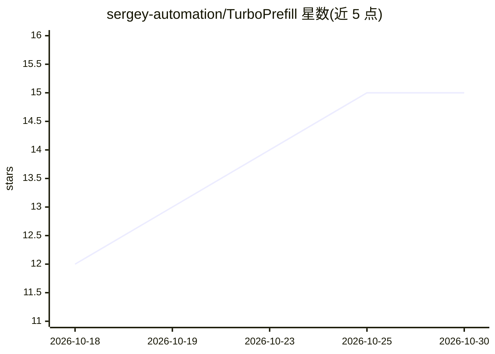

# sergey-automation/TurboPrefill

⭐ 15 · C++ · MIT · 推送 2026-10-23 · [GitHub](https://github.com/sergey-automation/TurboPrefill) · 个人维护

**llama.cpp 多 GPU 长上下文 prefill 调度加速补丁**

以 llama.cpp 文件覆盖层（file overlay）与基准脚本形式提供的 proof-of-concept：实现 Intra-Prompt Pipeline Scheduling，在多 GPU layer-split 模式下让多个 ubatch 同时在流水线中活跃，减少 GPU 空转，仅改变调度顺序，不修改模型权重与计算结果，输出与原路径一致。适用范围限定于长上下文 prefill；decode、单 GPU、embedding、非 layer-split 等工作负载仍走标准路径。README 公布多组 NVIDIA 显卡上的吞吐对比数据，另发布针对 ik_llama.cpp 的版本；新版本适配、ROCm 开发等不在 MIT 公开版内，并在寻找商业化合作。

## 筛选速览

| 维度 | 判定 | 备注 |
|---|---|---|
| AI 角色 | `ai-ecosystem` | LLM/agent 周边工具 |
| 许可风险 | `permissive` | MIT |
| 部署形态 | `library` | 以包/库形式分发 |
| 模型依赖 | local-ok | 支持本地模型 |
| 硬件要求 | — | 无带数字的原话,不猜 |
| 安装摩擦 | `high` | 编译与系统依赖俱全 |
| 成熟度 | `idea` | |

## 能力要点

- 仅改变调度策略，不改模型权重与计算，输出一致
- 覆盖层以 TurboPrefill=1 开关激活，不修改原代码路径，不匹配工作负载自动回落标准调度
- 降低对卡间带宽要求（基于 split_mode=layer，相对 -sm tensor 理论差距最高 320×）
- 同时提供 llama.cpp 与 ik_llama.cpp 两个版本的发布

## 适用场景

- 多 GPU layer-split 下长提示词（数万 token）的 prefill 吞吐提升
- 卡间带宽受限（如 PCIe 老旧链路）的多卡推理环境
- 多用户 llama-server 场景中的长上下文请求处理

## 场景标签

 · 领域:LLM 推理优化

## 证据(README 行号)

> L15: This repository contains a file overlay for llama.cpp and helper scripts for running `llama-server` benchmarks.
> L17: TurboPrefill is the first public proof-of-concept implementation of Intra-Prompt Pipeline Scheduling for Multi-GPU 
> L148: TurboPrefill does not modify model weights, computations, or inference results. Only the execution order of prefil

## 星数曲线

2026-10-18 12 → 2026-10-30 15（+3）

---
*卡片 v1 · prompt 1.4 · 生成 2026-10-30 · 置信度 mid · 依据 README sha `f6f4b54aa108` · [字段定义](../../DATASET.md)*
