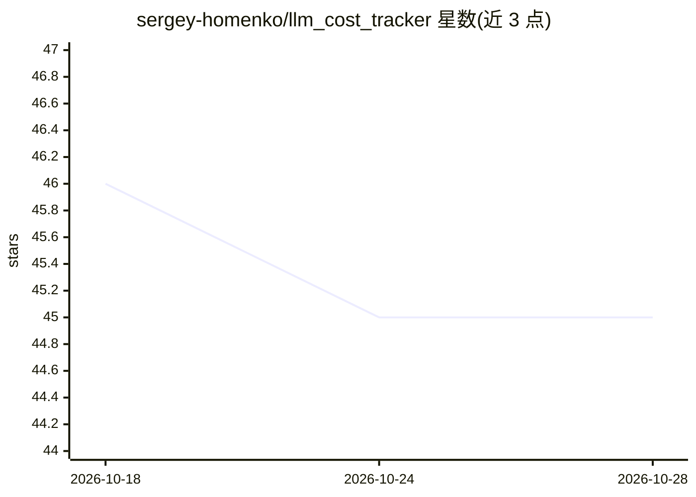

# sergey-homenko/llm_cost_tracker

⭐ 45 · Ruby · NOASSERTION · 推送 2026-10-28 · [GitHub](https://github.com/sergey-homenko/llm_cost_tracker) · [官网](https://rubygems.org/gems/llm_cost_tracker) · 个人维护

**Rails 应用的 LLM 支出记账与预算控制 gem**

面向 Rails 单体的 Ruby gem：通过 instrumentation 或 Faraday 钩子捕获 LLM 调用（聊天/嵌入/转录/图像/审核），按用户、功能或任意标签记录到自有数据库，无需代理；记录提供商、模型、token、成本、延迟及逐项计费明细与价格快照。支持按日/月/单次及按标签的预算，超限可回调、抛异常或拦截下一次调用。要求 Ruby 3.3+、Rails 8.0+、PostgreSQL 或 MySQL；提供挂载式 dashboard（不带鉴权）与手动 track 接口。不记录提示词、轨迹或重放，仅做支出归因。

## 筛选速览

| 维度 | 判定 | 备注 |
|---|---|---|
| AI 角色 | `ai-ecosystem` | LLM/agent 周边工具 |
| 许可风险 | `none` | NOASSERTION |
| 部署形态 | `None` |  |
| 模型依赖 | locked-api |  |
| 硬件要求 | — | 无带数字的原话,不猜 |
| 安装摩擦 | `low` | 无编译、无系统依赖或容器化 |
| 成熟度 | — | 结构信号不足 |

## 能力要点

- 按用户/功能/租户等标签的支出归因，数据存自有数据库、无代理
- 日/月/单次/按标签多维预算，超限可阻塞下一次调用
- 逐项计费明细（文本/音频/缓存 token、工具费用）与价格快照防漂移
- 支持 RubyLLM、OpenAI/Anthropic 官方 SDK、Azure OpenAI、Gemini 及 OpenAI 兼容网关

## 适用场景

- Rails 单体应用内按用户和功能核算 LLM 成本
- 为多租户或 agent 运行设置月度/单次预算并拦截超额调用
- 留存价格快照与提供商 ID 以支撑审计与 EU AI Act 记录

## 场景标签

`LLM 可观测性` · 领域:评测与运维

## 证据(README 行号)

> L3: LLM spend tracking and budgets for Rails: by user, feature, or any tag, in your own database, no proxy.
> L36: Your RubyLLM calls stay unchanged, and every chat, embedding, transcription, image, and moderation call now lands i

## 星数曲线

2026-10-18 46 → 2026-10-28 45（-1）

---
*卡片 v1 · prompt 1.4 · 生成 2026-10-25 · 置信度 high · 依据 README sha `eb018f0faeea` · [字段定义](../../DATASET.md)*
