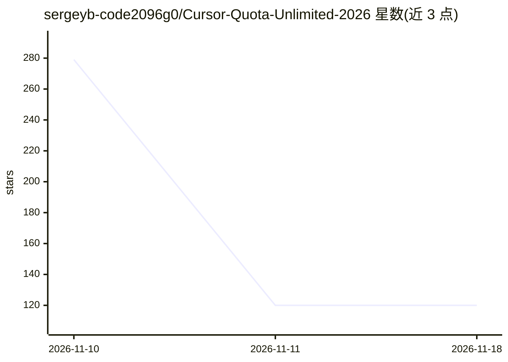

# sergeyb-code2096g0/Cursor-Quota-Unlimited-2026

⭐ — · [GitHub]() · 个人维护

**面向 Cursor 用户的 Windows 会话管理与提示优化桌面工具**

第三方 Windows 10/11 桌面应用，面向 Cursor AI 编码代理的重度使用者：提供实时会话仪表盘、会话规划器、提示效率助手、使用统计与 token 优化工具，以延长有效编码时间。通过下载压缩包并以管理员运行 installer.exe 安装（约 98 MB），安装流程包含绕过 SmartScreen 提示的步骤。README 声明不保存账户凭证，不能提高官方限额，且标注仅供教育测试用途、自动化使用可能违反平台服务条款。仅支持 Windows，无 Mac/Linux 版本。

## 筛选速览

| 维度 | 判定 | 备注 |
|---|---|---|
| AI 角色 | `ai-ecosystem` | LLM/agent 周边工具 |
| 许可风险 | `none` | — |
| 部署形态 | `desktop` | 安装包/桌面程序 |
| 模型依赖 | — | README 未给出锁定关系 |
| 硬件要求 | — | 无带数字的原话,不猜 |
| 安装摩擦 | `low` | 无编译、无系统依赖或容器化 |
| 成熟度 | — | 结构信号不足 |

## 能力要点

- 实时会话仪表盘与会话规划器
- 提示效率助手与 token 优化工具
- 使用统计与分析
- Windows 10/11 桌面应用，约 98 MB 安装包

## 适用场景

- 管理 Cursor 编码会话并跟踪用量
- 优化提示写法以减少 token 消耗
- 规划跨时间窗口的编码工作

## 场景标签

`提示工程` · 领域:Agent 开发

## 证据(README 行号)

> L15: **Cursor Session Optimizer 2026** is a lightweight Windows desktop application designed for power users of the Curs
> L64: **Is this an official Cursor tool?**

## 星数曲线

2026-11-10 279 → 2026-11-18 120（-159）

---
*卡片 v1 · prompt 1.4 · 生成 2026-11-17 · 置信度 mid · 依据 README sha `d872cda3d3c8` · [字段定义](../../DATASET.md)*
