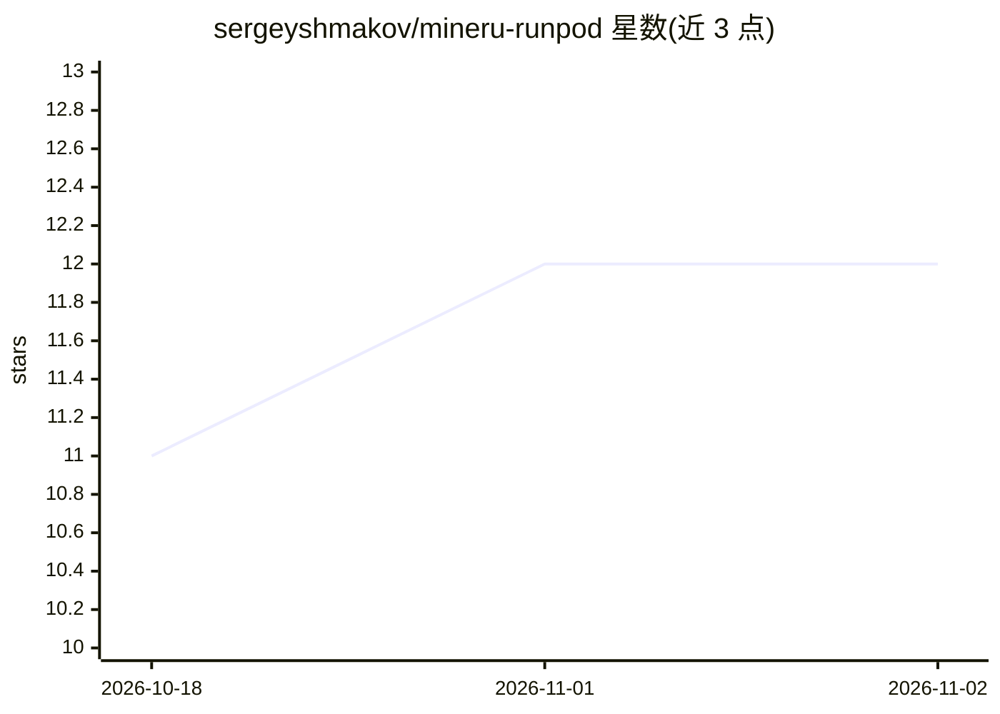

# sergeyshmakov/mineru-runpod

⭐ 12 · Python · MIT · 推送 2026-10-30 · [GitHub](https://github.com/sergeyshmakov/mineru-runpod) · [官网](https://mineru.shmakov.tools) · 个人维护

**将 MinerU 文档解析器打包为 RunPod Serverless GPU worker**

第三方（非官方）封装项目：把开源 MinerU 3.4.x 运行时（MinerU2.5-Pro-2605-1.2B VLM）打包成 RunPod Serverless worker，支持缩容到零的按秒计费 GPU 解析，输入 PDF/图片/Office 文档，输出 Markdown、content_list、middle.json 与图片，可选 tarball_b64/inline/s3 三种传输模式。提供 Python 客户端 mineru_client（含模拟官方 MinerU 云 API 的兼容门面）与直接 HTTP/RunPod SDK 调用两种接入方式。包装代码 MIT，底层 MinerU 及模型遵循其自有许可。

## 筛选速览

| 维度 | 判定 | 备注 |
|---|---|---|
| AI 角色 | `ai-ecosystem` | LLM/agent 周边工具 |
| 许可风险 | `permissive` | MIT |
| 部署形态 | `library` | 以包/库形式分发 |
| 模型依赖 | — | README 未给出锁定关系 |
| 硬件要求 | — | 无带数字的原话,不猜 |
| 安装摩擦 | `low` | 无编译、无系统依赖或容器化 |
| 成熟度 | — | 结构信号不足 |

## 能力要点

- RunPod Serverless 部署，缩容到零，按秒计费
- 支持 PDF/图片/DOCX/PPTX/XLSX 解析为 Markdown+JSON
- MineruApiClient 兼容官方 MinerU 云 API 的 create_task/get_task 接口
- 三种输出传输模式（tarball_b64/inline/s3）与可裁剪的 formats

## 适用场景

- 按需调用 GPU 做 PDF→Markdown 解析而无需常驻 GPU
- 从官方 MinerU 云 API 迁移到自托管端点
- 为 RAG 管线批量生成结构化文档

## 场景标签

`文档解析` · 领域:知识与检索

## 证据(README 行号)

> L10: Serverless MinerU document parser on RunPod. MinerU 3.4.x runtime with the `MinerU2.5-Pro-2605-1.2B` VLM. Scales to
> L14: > ⚠️ **Not an official MinerU project.** This is an independent wrapper that packages the open-source MinerU runtim
> L46: - Wiring the two together is the part this repo does for you. Deploy from the RunPod Hub in one click, or fork the 

## 星数曲线

2026-10-18 11 → 2026-11-02 12（+1）

---
*卡片 v1 · prompt 1.4 · 生成 2026-11-01 · 置信度 high · 依据 README sha `c454db938d53` · [字段定义](../../DATASET.md)*
