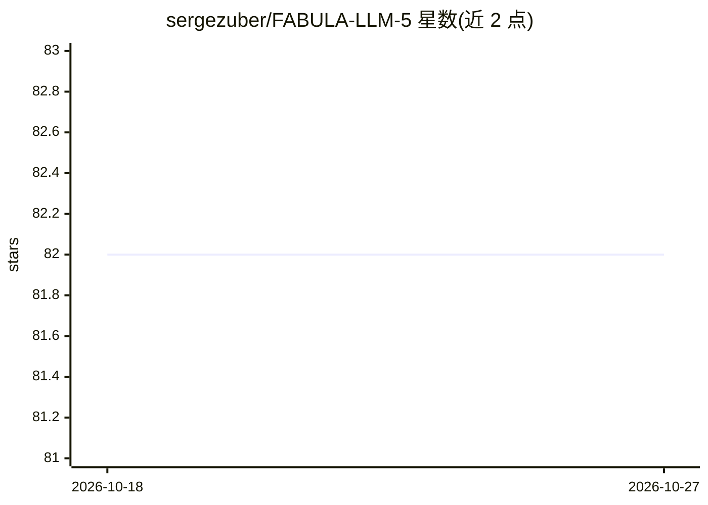

# sergezuber/FABULA-LLM-5

⭐ 82 · TypeScript · MIT · 推送 2026-09-22 · [GitHub](https://github.com/sergezuber/FABULA-LLM-5) · [官网](https://github.com/sergezuber/FABULA-LLM-5/blob/main/docs/spec/verified-autonomy-receipt-v0.2.md) · 个人维护 · 中文 README

**本地优先编码 agent：测试全绿才结束并生成可回放收据**

面向单机单模型的编码 agent，macOS 桌面应用（Linux/Windows 为本地服务器+Web UI），基于 MiMoCode（OpenCode fork）。核心机制：引擎运行循环强制在项目自身测试跑绿后才标记 VERIFIED，否则显式 NOT DONE；每次绿色运行生成 Proof-of-Done 收据（diff、base commit、验证命令），可用 fabula receipt verify 重放。针对单推理槽优化：字节稳定前缀保 KV cache、按固定开销决定压缩、请求排队。模型经 LM Studio/MLX 或任何 OpenAI 兼容端点接入，需支持工具调用。无账号无遥测。文档明确列出未测量的声明（如 finish guard 效果未测量）。

## 筛选速览

| 维度 | 判定 | 备注 |
|---|---|---|
| AI 角色 | `ai-native` | 本体是模型或模型工具 |
| 许可风险 | `permissive` | MIT |
| 部署形态 | `desktop` | 安装包/桌面程序 |
| 模型依赖 | — | README 未给出锁定关系 |
| 硬件要求 | — | 无带数字的原话,不猜 |
| 安装摩擦 | `low` | 无编译、无系统依赖或容器化 |
| 成熟度 | — | 结构信号不足 |

## 能力要点

- 引擎级 finish guard：测试未跑绿不结束，重入有界，超限显式 NOT DONE
- Proof-of-Done 收据：记录 diff/base commit/验证命令，可 throwaway worktree 中重放
- 单模型单推理槽优化：字节稳定前缀、固定开销感知压缩、请求排队适配器
- 23 插件 62 工具，容器/内核级隔离（Seatbelt/bubblewrap）、SSRF 与密钥脱敏防护

## 适用场景

- 在小模型上跑编码任务并强制测试验证后才交付
- 生成可回放的工作收据供他人核验
- 离线/无遥测环境下的本地编码 agent

## 场景标签

`编码 Agent` · 领域:编码与开发

## 证据(README 行号)

> L19: FABULA is a coding agent built for **one model on one machine** — a small local model served by LM Studio or MLX, o
> L29: In a project with tests, an edit is not finished until the project's own tests have run green after it. A turn that

## 星数曲线

2026-10-18 82 → 2026-10-27 82（+0）

---
*卡片 v1 · prompt 1.4 · 生成 2026-10-24 · 置信度 high · 依据 README sha `a3e79935cacc` · [字段定义](../../DATASET.md)*
