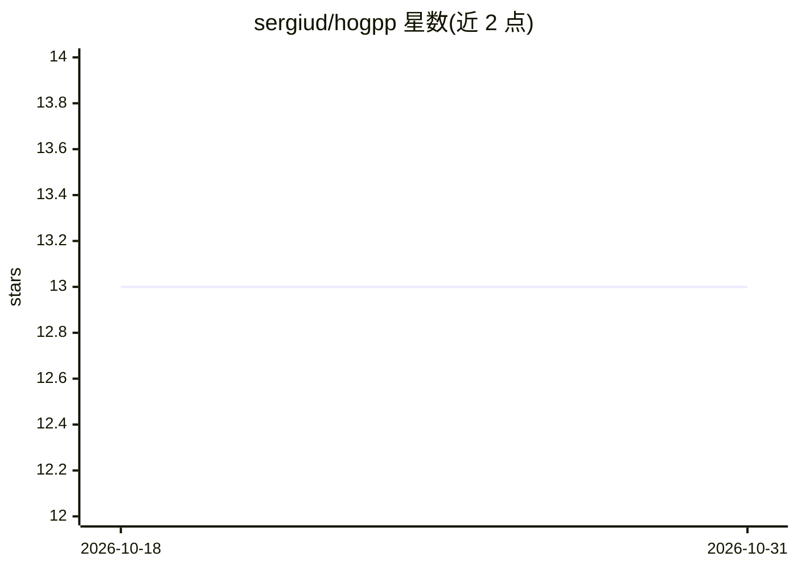

# sergiud/hogpp

⭐ 13 · C++ · Apache-2.0 · 推送 2026-10-26 · [GitHub](https://github.com/sergiud/hogpp) · [官网](https://hogpp.readthedocs.io) · 个人维护

**R-HOG 特征快速计算的 Python/C++ 库，基于积分直方图**

提供基于积分直方图实现的矩形梯度方向直方图（R-HOG）特征描述子，可对任意子区域在常数时间内计算 HOG 特征，适用于滑窗检测等大量重叠区域的特征提取场景。C++ 模板实现并绑定 Python，支持 32/64/80 位浮点精度、任意尺寸输入、8-64 位整数与浮点输入、梯度幅值掩码排除。README 提及与 OpenCV HOG 实现的差异对比（OpenCV 4.5.5 要求输入为块尺寸倍数、仅 8 位无符号整数）。Apache 2.0 许可。

## 筛选速览

| 维度 | 判定 | 备注 |
|---|---|---|
| AI 角色 | `ai-native` | 本体是模型或模型工具 |
| 许可风险 | `permissive` | Apache-2.0 |
| 部署形态 | `library` | 以包/库形式分发 |
| 模型依赖 | — | README 未给出锁定关系 |
| 硬件要求 | — | 无带数字的原话,不猜 |
| 安装摩擦 | `low` | 无编译、无系统依赖或容器化 |
| 成熟度 | — | 结构信号不足 |

## 能力要点

- 积分直方图使任意子区域 HOG 特征常数时间计算
- 支持 32/64/80 位浮点精度
- 任意尺寸输入与 8-64 位整数/浮点输入
- 梯度幅值空间掩码排除

## 适用场景

- 滑窗检测中大量重叠区域的特征提取
- 需要非块尺寸倍数图像输入的 HOG 计算
- 需要排除特定图像区域的特征提取

## 场景标签

`图像视频处理` · 领域:感知与多模态

## 证据(README 行号)

> L10: This repository implements the rectangular histogram of oriented gradients
> L13: regardless of its size. This is particularly useful when extracting features

## 星数曲线

2026-10-18 13 → 2026-10-31 13（+0）

---
*卡片 v1 · prompt 1.4 · 生成 2026-10-31 · 置信度 high · 依据 README sha `c1b1a6b0e9c9` · [字段定义](../../DATASET.md)*
