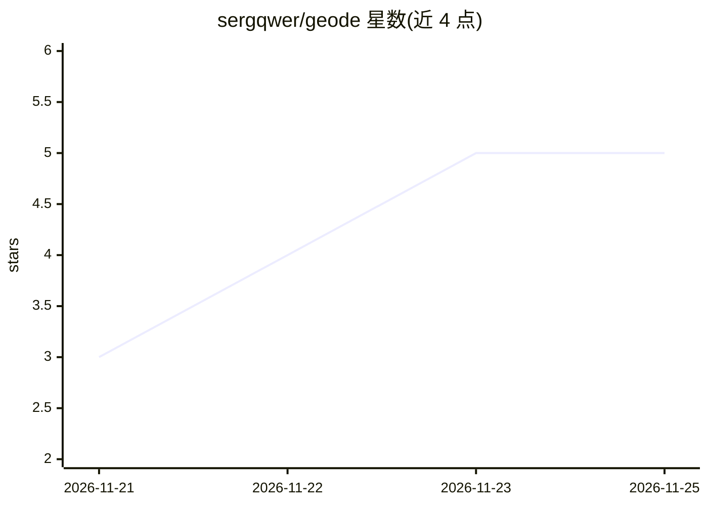

# sergqwer/geode

⭐ 5 · C++ · AGPL-3.0 · 推送 2026-11-19 · [GitHub](https://github.com/sergqwer/geode) · [官网](https://geode.tifu.xyz) · 个人维护

**在 Android 手机本地离线运行大模型的聊天、作曲与生图应用**

Geode 是一个 Android 应用，在手机本地运行语言、多模态、歌曲生成与图像生成模型：Qwen3.6-35B-A3B（专家权重从闪存流式读取）、Gemma 4（照片/视频/声音理解）、Qwen3.5-2B、YuE2 作曲与 FLUX.2 klein 生图。推理引擎为手机 CPU（NEON）、Adreno GPU（OpenCL）与 Hexagon NPU（HVX/HMX）提供自有 kernel，可单芯片或双芯片运行。带浏览器 Agent（proot Debian + Chromium）、本地 OpenAI/Anthropic 兼容 API 服务器。需 Android 11+ arm64；YuE2 生成内容限非商业用途。

## 筛选速览

| 维度 | 判定 | 备注 |
|---|---|---|
| AI 角色 | `ai-native` | 本体是模型或模型工具 |
| 许可风险 | `dual` | AGPL-3.0 |
| 部署形态 | `None` |  |
| 模型依赖 | — | README 未给出锁定关系 |
| 硬件要求 | — | 无带数字的原话,不猜 |
| 安装摩擦 | `medium` | 含编译或系统依赖之一 |
| 成熟度 | — | 结构信号不足 |

## 能力要点

- 自有推理引擎支持 CPU/GPU/NPU 双芯片协同运行
- 35B MoE 模型专家从闪存流式读取，数 GB RAM 运行 20 GB 模型
- Agent 配有 proot Linux 与手机 Chromium 浏览器操作网页
- 本地服务器提供 OpenAI/Anthropic 兼容 API 与音乐、图像端点

## 适用场景

- 在手机上离线进行多模态对话与图像理解
- 用歌词在手机本地生成并逐段编辑歌曲
- 在手机本地从文本生成与编辑图片
- 让带浏览器的 Agent 执行网页搜索与文件操作

## 场景标签

`浏览器自动化` `图像生成` `多模态` `推理引擎` · 领域:效率与自动化

## 证据(README 行号)

> L24: Geode runs large language models on a phone. It needs no server: the app, the model and the agent's tools stay on t
> L33: The inference engine is written from scratch for phone hardware. It has its own kernels for the CPU (NEON), the
> L47: - **Images**: a picture from a few words, drawn on the phone by FLUX.2 [klein] 4B, with a live preview after each

## 星数曲线

2026-11-21 3 → 2026-11-25 5（+2）

---
*卡片 v1 · prompt 1.4 · 生成 2026-11-21 · 置信度 high · 依据 README sha `53c527eebd16` · [字段定义](../../DATASET.md)*
