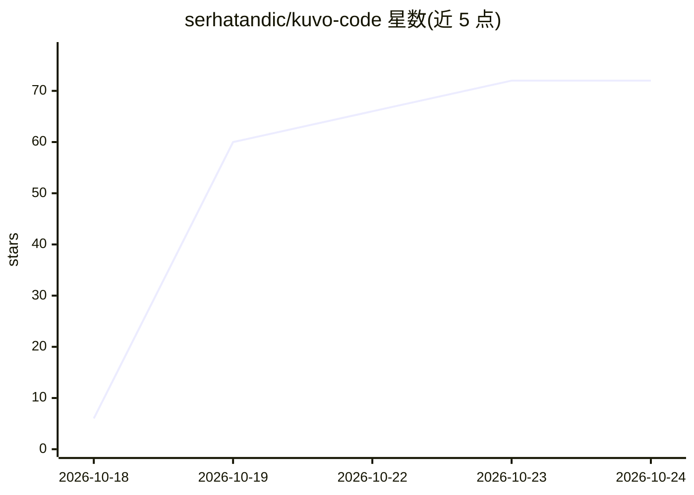

# serhatandic/kuvo-code

⭐ 73 · Swift · NOASSERTION · 推送 2026-10-24 · [GitHub](https://github.com/serhatandic/kuvo-code) · [官网](https://kuvo.run/code) · 个人维护

**macOS 原生编码 agent 界面，基于 opencode 引擎，任意模型可用**

用 SwiftUI 编写的 macOS 原生应用，作为 opencode 编码 agent 引擎（官方 @opencode/cli 二进制，未修改）的界面：按项目管理会话、以类 PR 方式审阅并逐行评论代码变更，侧栏集成文件、终端与供 agent 使用的浏览器。支持订阅账号、API key 或免注册模型接入 Claude、GPT、Gemini 及 OpenRouter 等 opencode 提供方，并可经 SSH 在远程 Linux 机器上运行会话。需 Apple silicon 且 macOS 26 及以上，许可证为 PolyForm Noncommercial。

## 筛选速览

| 维度 | 判定 | 备注 |
|---|---|---|
| AI 角色 | `ai-ecosystem` | LLM/agent 周边工具 |
| 许可风险 | `none` | NOASSERTION |
| 部署形态 | `desktop` | 安装包/桌面程序 |
| 模型依赖 | — | README 未给出锁定关系 |
| 硬件要求 | — | 无带数字的原话,不猜 |
| 安装摩擦 | `low` | 无编译、无系统依赖或容器化 |
| 成熟度 | — | 结构信号不足 |

## 能力要点

- 运行未修改的官方 opencode 引擎，经校验签名后私有服务器方式调用
- 类 PR 的变更审阅：折叠未改行、前后截图对比、行评论随下条消息发给 agent
- 侧栏文件/终端/浏览器，agent 可读取、点击、输入网页
- Claude Code、Codex、Cursor、Grok、Antigravity 可并行运行并跨 agent 移交会话

## 适用场景

- 在 Mac 上用任意模型跑编码 agent 并审阅其改动
- 把 agent 会话放到家中服务器或 VPS 上持续运行
- 多个编码 agent 之间切换和接力同一会话

## 场景标签

`编码 Agent` · 领域:编码与开发

## 证据(README 行号)

> L11: Kuvo Code is a native macOS harness for coding agents that works with any
> L70: - **The engine is opencode itself**: the official, signed `@opencode/cli`
> L74: - **Each launch runs a private server**, `opencode serve --stdio --port 0`

## 星数曲线

2026-10-18 6 → 2026-10-24 72（+66）

---
*卡片 v1 · prompt 1.4 · 生成 2026-10-24 · 置信度 high · 依据 README sha `ccb3ccf0b4f7` · [字段定义](../../DATASET.md)*
