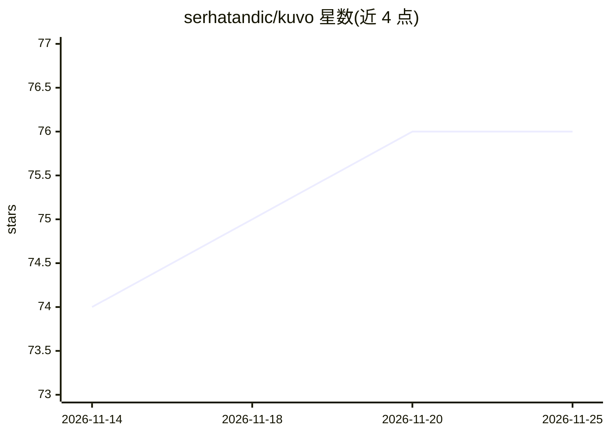

# serhatandic/kuvo

⭐ 76 · TypeScript · NOASSERTION · 推送 2026-11-23 · [GitHub](https://github.com/serhatandic/kuvo) · [官网](https://kuvo.run/code) · 个人维护

**给 Mac 用户的原生 coding agent 客户端：任意模型运行编码智能体**

SwiftUI 编写的 macOS 原生应用，作为 opencode 引擎（官方 @opencode/cli，未修改）的图形界面运行：提供按项目组织的会话、类似 pull request 的改动审阅与行内评论、文件/终端/浏览器侧栏，并支持 agent 在面板浏览器中浏览页面。可创建具名 bot（定时唤醒、群聊、部署到自有服务器），支持 Claude、GPT、Gemini、OpenRouter 开源模型等多种模型接入。通过 SSH 接入远程 Mac 或 Linux 机器，使会话在本地关闭后继续运行。要求 Apple silicon 与 macOS 26+，License 为 PolyForm Noncommercial（非商业）。更新经 Sparkle 分发并经 Apple 签名公证。

## 筛选速览

| 维度 | 判定 | 备注 |
|---|---|---|
| AI 角色 | `ai-native` | 本体是模型或模型工具 |
| 许可风险 | `none` | NOASSERTION |
| 部署形态 | `desktop` | 安装包/桌面程序 |
| 模型依赖 | locked-api |  |
| 硬件要求 | — | 无带数字的原话,不猜 |
| 安装摩擦 | `low` | 无编译、无系统依赖或容器化 |
| 成熟度 | — | 结构信号不足 |

## 能力要点

- 以未修改的 opencode 官方二进制为引擎，SwiftUI 原生界面
- 类 pull request 的 git 改动审阅，行内评论随下一条消息发给 agent
- 可部署到自有服务器的具名 bot：定时唤醒、群聊协作
- 通过 SSH 隧道在远程 Mac/Linux 机器上运行会话，本地关机不中断

## 适用场景

- 在 Mac 上用自己选择的模型运行编码 agent 完成项目改动
- 审阅 agent 的未提交改动并逐行给反馈
- 把定时任务型 AI bot（如保持构建通过）部署到自己的服务器持续运行

## 场景标签

`编码 Agent` · 领域:编码与开发

## 证据(README 行号)

> L11: Kuvo Code is a native macOS harness for coding agents that works with any
> L12: model. Its engine is opencode,
> L34: - **Any model.** Claude, GPT, Gemini, open models through OpenRouter,

## 星数曲线

2026-11-14 74 → 2026-11-25 76（+2）

---
*卡片 v1 · prompt 1.4 · 生成 2026-11-18 · 置信度 high · 依据 README sha `81a397e082ac` · [字段定义](../../DATASET.md)*
