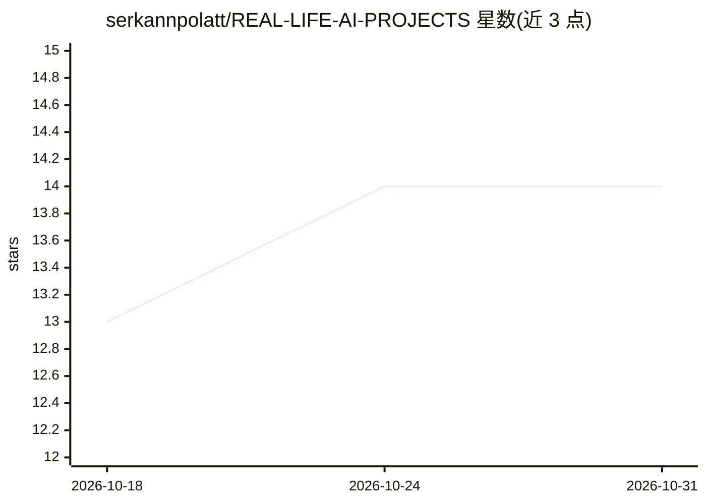

# serkannpolatt/REAL-LIFE-AI-PROJECTS

⭐ 14 · Jupyter Notebook · 推送 2026-09-19 · [GitHub](https://github.com/serkannpolatt/REAL-LIFE-AI-PROJECTS) · 个人维护

**面向现实问题的实用 AI 项目集合（仓库自述）**

该仓库收录将机器学习技术应用于现实问题的实践型 AI 项目，仓库描述提及 agent、多模态、RAG、SQL、端到端、数据科学等主题标签，使用 Python 构建。但 README 可见内容仅一行图片占位文本（ezgif 动图文件名），无项目清单、安装方式或使用说明可验证的事实。本条目基于仓库描述与主题标签编目，详情需查看仓库代码目录。

## 筛选速览

| 维度 | 判定 | 备注 |
|---|---|---|
| AI 角色 | `ai-knowledge` | 知识聚合/清单类 |
| 许可风险 | `none` | — |
| 部署形态 | `None` |  |
| 模型依赖 | — | README 未给出锁定关系 |
| 硬件要求 | — | 无带数字的原话,不猜 |
| 安装摩擦 | `low` | 无编译、无系统依赖或容器化 |
| 成熟度 | — | 结构信号不足 |

## 能力要点

- 收录实践型 AI 项目（仓库描述自述）
- 主题标签覆盖 agent、多模态、RAG、SQL、端到端
- 使用 Python

## 适用场景

- 查找端到端 AI 项目作为学习或参考实现
- 浏览 RAG、多模态等方向的示例项目

## 场景标签

 · 领域:AI 项目集合/数据科学

## 星数曲线

2026-10-18 13 → 2026-10-31 14（+1）

---
*卡片 v1 · prompt 1.4 · 生成 2026-10-31 · 置信度 low · 依据 README sha `d754187418c5` · [字段定义](../../DATASET.md)*
