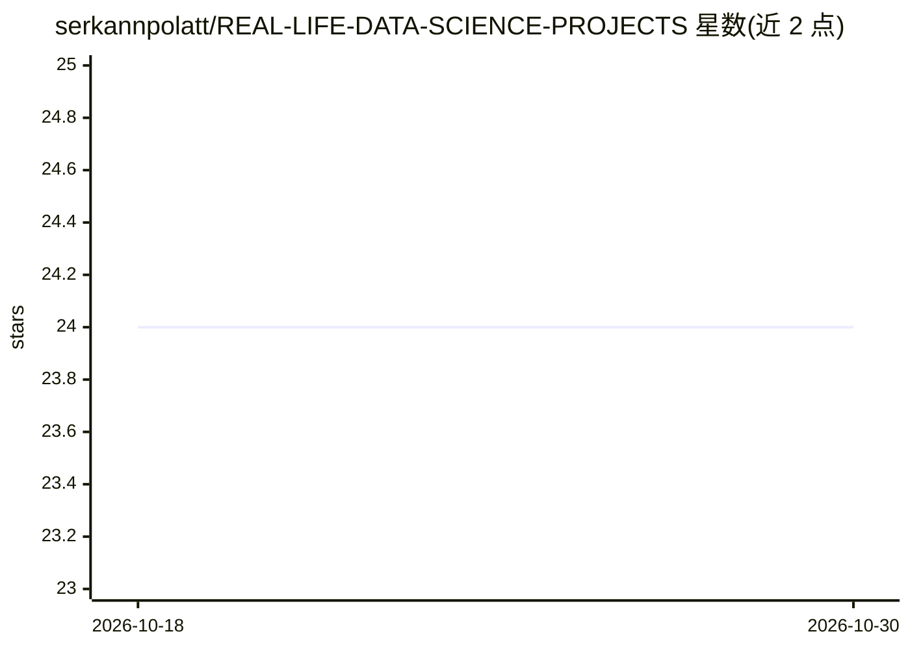

# serkannpolatt/REAL-LIFE-DATA-SCIENCE-PROJECTS

⭐ 24 · Jupyter Notebook · MIT · 推送 2026-10-24 · [GitHub](https://github.com/serkannpolatt/REAL-LIFE-DATA-SCIENCE-PROJECTS) · 个人维护

**面向学习者的真实场景数据科学项目集合**

由个人维护的数据科学项目聚合仓库，README 以英文与土耳其语双语说明各项目遵循统一流程：问题定义、数据采集、清洗、探索性分析、特征工程、模型训练与评估、部署及后续监控。面向初学者、学生、从业者与教师，用作学习参考与作品集素材。README 仅描述方法论框架，未列出具体项目清单、数据集或安装运行命令。

## 筛选速览

| 维度 | 判定 | 备注 |
|---|---|---|
| AI 角色 | `ai-knowledge` | 知识聚合/清单类 |
| 许可风险 | `permissive` | MIT |
| 部署形态 | `None` |  |
| 模型依赖 | — | README 未给出锁定关系 |
| 硬件要求 | — | 无带数字的原话,不猜 |
| 安装摩擦 | `low` | 无编译、无系统依赖或容器化 |
| 成熟度 | — | 结构信号不足 |

## 能力要点

- 每项目遵循 9 阶段结构化流程（从问题定义到部署监控）
- 双语（英语/土耳其语）说明
- 面向初学者、学生、从业者、教师四类人群

## 适用场景

- 初学者通过真实场景项目学习数据科学全流程
- 学生参考项目结构构建个人作品集
- 教师选取实例讲授数据科学方法论

## 场景标签

`教程课程` · 领域:学习与行业

## 证据(README 行号)

> L4: This repository contains various real-life data science projects that demonstrate practical applications of data sci
> L18: - **Data Science Beginners**: Individuals who are new to data science and want to understand practical applications

## 星数曲线

2026-10-18 24 → 2026-10-30 24（+0）

---
*卡片 v1 · prompt 1.4 · 生成 2026-10-27 · 置信度 mid · 依据 README sha `ca10892f44cc` · [字段定义](../../DATASET.md)*
