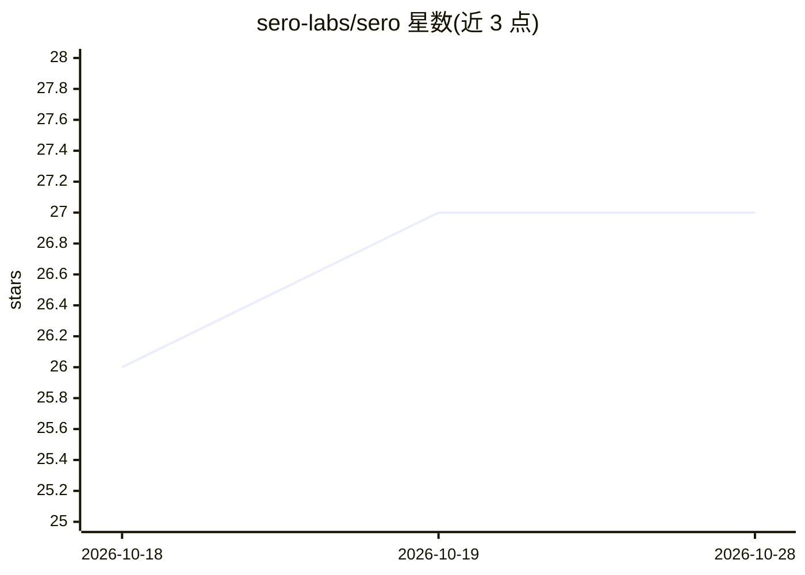

# sero-labs/sero

⭐ 27 · TypeScript · Apache-2.0 · 推送 2026-10-27 · [GitHub](https://github.com/sero-labs/sero) · [官网](https://sero-ai.dev/) · 组织维护

**本地优先的 AI agent 桌面工作区，承载 Pi 编码代理运行**

基于 Pi 编码代理构建的 Electron + React 桌面工作区，把聊天会话、终端、可视化浏览器、预览、VCS、插件与持久化项目记忆整合到一个 shell 中。支持 Apple Container、Docker/Podman 与主机三种运行时隔离，插件可暴露 Pi 工具、斜杠命令、React UI、小组件与后台任务。当前为公开 beta：支持 macOS Apple Silicon、Linux x64/arm64、Windows x64，插件/运行时契约可能变化，更新为手动方式。面向进行 agent 辅助软件开发的开发者。

## 筛选速览

| 维度 | 判定 | 备注 |
|---|---|---|
| AI 角色 | `ai-ecosystem` | LLM/agent 周边工具 |
| 许可风险 | `permissive` | Apache-2.0 |
| 部署形态 | `library` | 以包/库形式分发 |
| 模型依赖 | — | README 未给出锁定关系 |
| 硬件要求 | — | 无带数字的原话,不猜 |
| 安装摩擦 | `low` | 无编译、无系统依赖或容器化 |
| 成熟度 | `idea` | |

## 能力要点

- 统一桌面 shell：聊天、终端、可视化浏览器、预览、VCS 与插件一体
- 运行时隔离：Apple Container、Docker/Podman 与显式 Host 模式
- 插件可提供 Pi 工具、斜杠命令、React UI、小组件与后台行为
- 跨会话的项目级持久记忆

## 适用场景

- 在本地一个工作区内完成 agent 辅助的软件开发全流程
- 让 agent 在内置浏览器中查看页面、截图并基于屏幕内容推理
- 通过插件扩展 agent 的工具、命令与界面能力

## 场景标签

`编码 Agent` `浏览器自动化` · 领域:效率与自动化

## 证据(README 行号)

> L17: Sero is a **personal agent OS** built directly on the
> L20: Pi gives you the minimal, stable agent loop. Sero adds the always-on desktop
> L95: - Electron + React desktop shell for agent-assisted development

## 星数曲线

2026-10-18 26 → 2026-10-28 27（+1）

---
*卡片 v1 · prompt 1.4 · 生成 2026-10-26 · 置信度 mid · 依据 README sha `938bacd564ad` · [字段定义](../../DATASET.md)*
