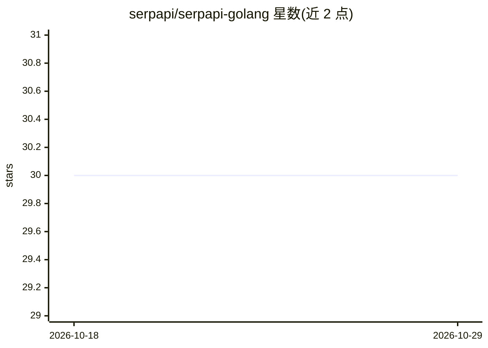

# serpapi/serpapi-golang

⭐ 30 · Go · MIT · 推送 2026-10-21 · [GitHub](https://github.com/serpapi/serpapi-golang) · [官网](https://serpapi.com) · 组织维护

**SerpApi 官方 Go 库：在 Go 应用中接入搜索引擎结果数据**

SerpApi HTTP 接口的官方 Go 封装库，面向需要在 Go 应用中获取搜索数据的开发者。支持 Google 全系（搜索/地图/学术/购物/机票等）及 Baidu、Yandex、eBay、YouTube、DuckDuckGo 等多个引擎。提供三种响应格式：Search 返回解析后的 JSON map、Md 返回面向 LLM 与 AI agent 的 token 高效 Markdown、Html 返回原始 HTML。另含图片上传、Location、Search Archive、Account 等接口，全部方法提供 Context 变体用于请求级取消与超时。需要 Go 1.17+ 与 SerpApi API key。

## 筛选速览

| 维度 | 判定 | 备注 |
|---|---|---|
| AI 角色 | `ai-ecosystem` | LLM/agent 周边工具 |
| 许可风险 | `permissive` | MIT |
| 部署形态 | `None` |  |
| 模型依赖 | — | README 未给出锁定关系 |
| 硬件要求 | — | 无带数字的原话,不猜 |
| 安装摩擦 | `low` | 无编译、无系统依赖或容器化 |
| 成熟度 | — | 结构信号不足 |

## 能力要点

- Search/Md/Html 三种响应格式，Md 为面向 LLM 的 Markdown 输出
- 覆盖 Google 全系及 Baidu/Yandex/eBay/Walmart 等 20+ 引擎示例
- 全部 API 提供 Context 感知变体与结构化 HTTPError 错误类型
- 支持 async=true 非阻塞批量搜索与图片上传（500KB 内，10 分钟过期）

## 适用场景

- 在 Go 服务中获取各搜索引擎的结构化结果数据
- 为 LLM 或 AI agent 提供以 Markdown 格式返回的搜索结果
- 按 search_id 检索历史搜索结果归档

## 场景标签

`网页抓取` · 领域:效率与自动化

## 证据(README 行号)

> L5: Integrate search data into your Go application. This library is the official wrapper for SerpApi.
> L37: Use `Md` for a token-efficient Markdown string optimized for LLMs and AI agents:

## 星数曲线

2026-10-18 30 → 2026-10-29 30（+0）

---
*卡片 v1 · prompt 1.4 · 生成 2026-10-26 · 置信度 high · 依据 README sha `51072a0689c0` · [字段定义](../../DATASET.md)*
