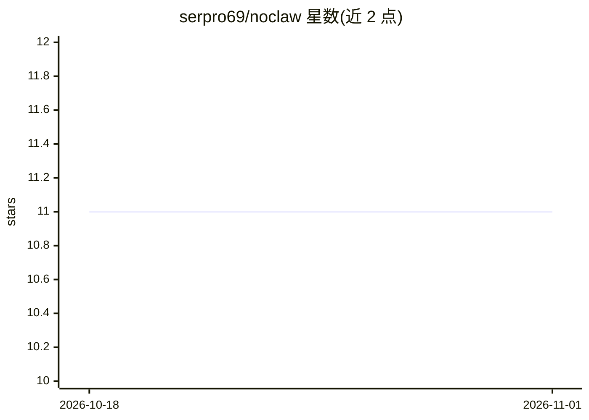

# serpro69/noclaw

⭐ 11 · 推送 2026-02-20 · [GitHub](https://github.com/serpro69/noclaw) · 个人维护

**零依赖零配置的空壳 AI agent 框架：不做任何事以实现零安全风险**

以讽刺形式回应 OpenClaw 安全事件的项目：宣称通过不实现任何功能（0 行代码、0 字节安装、从不启动）来获得 0 CVE、0 恶意技能与 0 暴露实例。README 主体是 OpenClaw 2026 年初三周安全时间线的整理（CVE-2026-25253、ClawHavoc 恶意技能活动、Moltbook 数据泄露等）与专家引语汇编，并附功能对比表、威胁模型与 FAQ。安装即空操作，另有 git clone 的'高级安装'与浏览器运行说明。产品本身无实际功能。

## 筛选速览

| 维度 | 判定 | 备注 |
|---|---|---|
| AI 角色 | `ai-ecosystem` | LLM/agent 周边工具 |
| 许可风险 | `none` | — |
| 部署形态 | `None` |  |
| 模型依赖 | — | README 未给出锁定关系 |
| 硬件要求 | — | 无带数字的原话,不猜 |
| 安装摩擦 | `low` | 无编译、无系统依赖或容器化 |
| 成熟度 | — | 结构信号不足 |

## 能力要点

- 宣称 0 行代码、0 字节安装体积、从不启动
- 整理 OpenClaw 安全事件时间线（CVE、ClawHavoc、Moltbook 泄露等）
- 安装为空操作，无 Docker/npm/运行时依赖

## 适用场景

- 了解 OpenClaw 2026 年安全事件的经过与各方引语
- 作为 AI agent 安全风险的 satire 参照物

## 场景标签

 · 领域:AI agent 安全/讽刺

## 证据(README 行号)

> L8: We took their advice. We removed the claws. And the legs. And the body. What remains is **NoClaw**: a zero-dependenc
> L73: Compare this with OpenClaw's architecture, which a comprehensive security audit found to contain **512 vulnerabilit

## 星数曲线

2026-10-18 11 → 2026-11-01 11（+0）

---
*卡片 v1 · prompt 1.4 · 生成 2026-11-01 · 置信度 mid · 依据 README sha `1298da1405b9` · [字段定义](../../DATASET.md)*
