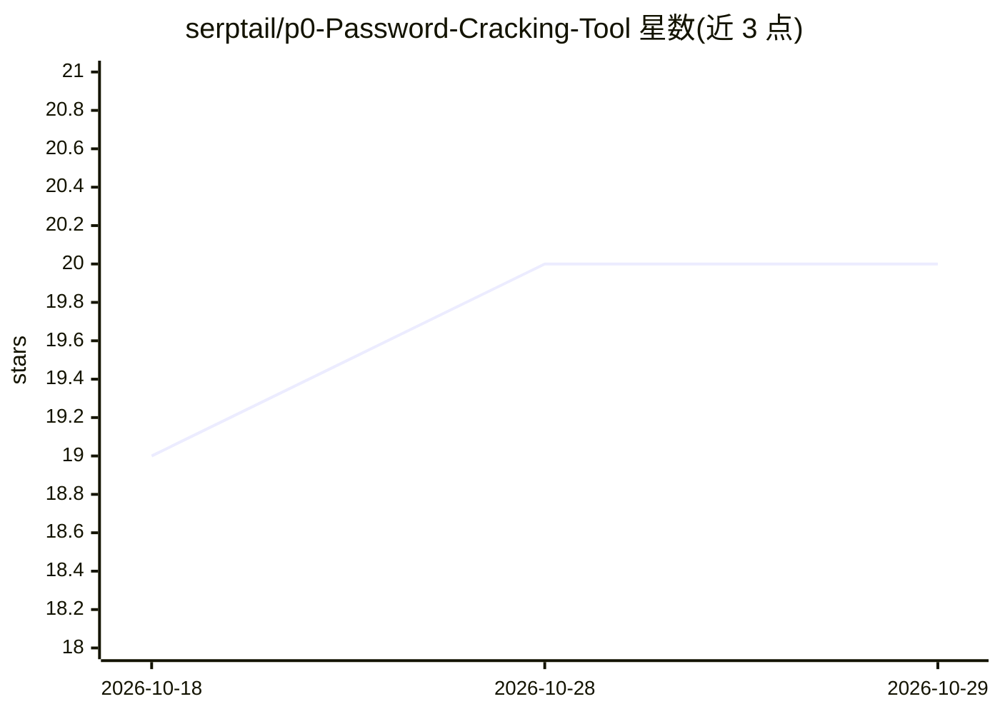

# serptail/p0-Password-Cracking-Tool

⭐ 20 · Python · AGPL-3.0 · 推送 2026-09-09 · [GitHub](https://github.com/serptail/p0-Password-Cracking-Tool) · [官网](https://serptail.github.io/p0-Password-Cracking-Tool/) · 个人维护

**带 AI 候选生成的桌面级哈希破解工具（hashcat 后端）**

Windows 桌面哈希破解工具：原生 Python/CPU 哈希路径（MD5、SHA 系列、bcrypt 等）与可选 hashcat/GPU 后端配合，支持 20 余种哈希算法与五种攻击模式（字典、暴力、规则、概率、彩虹表）。AI 部分为 GPT-2 风格 ONNX transformer，按 token 采样生成候选密码，可调温度/top-k/top-p。彩虹表基于 SQLite+Bloom 过滤+内存缓存分层存储，破解结果自动回填。提供 Windows 可执行包与源码运行两种安装方式，附带仅限教育与个人使用的法律声明。

## 筛选速览

| 维度 | 判定 | 备注 |
|---|---|---|
| AI 角色 | `ai-enhanced` | 去掉 AI 部分产品仍成立 |
| 许可风险 | `viral` | AGPL-3.0 |
| 部署形态 | `desktop` | 安装包/桌面程序 |
| 模型依赖 | — | README 未给出锁定关系 |
| 硬件要求 | — | 无带数字的原话,不猜 |
| 安装摩擦 | `medium` | 含编译或系统依赖之一 |
| 成熟度 | — | 结构信号不足 |

## 能力要点

- GPT-2 风格 ONNX transformer 按温度/top-k/top-p 采样生成候选密码
- 原生 Python 哈希路径 + 可选 hashcat GPU 后端，支持设备选择
- 20+ 哈希算法与 5 种攻击模式（字典/暴力/规则/概率/彩虹表）
- SQLite+Bloom 过滤+内存缓存的彩虹表存储，破解结果自动回填

## 适用场景

- 教育场景演示密码哈希与破解技术原理
- 对自己拥有权限的哈希执行恢复测试
- 用概率模型生成可能的密码候选而非盲目枚举

## 场景标签

`网络安全` · 领域:学习与行业

## 证据(README 行号)

> L8: PolycryptZero is a desktop hash-cracking tool. It combines a Python/CPU hashing path, an optional hashcat/GPU backen
> L28: |**Probabilistic (AI)**|An ONNX transformer generates candidates token-by-token|CPU or hashcat|

## 星数曲线

2026-10-18 19 → 2026-10-29 20（+1）

---
*卡片 v1 · prompt 1.4 · 生成 2026-10-28 · 置信度 mid · 依据 README sha `00dd0149a63b` · [字段定义](../../DATASET.md)*
