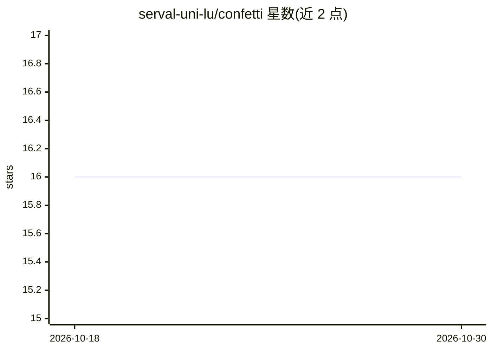

# serval-uni-lu/confetti

⭐ 16 · Python · MIT · 推送 2026-06-21 · [GitHub](https://github.com/serval-uni-lu/confetti) · [官网](https://confetti-ts.readthedocs.io/en/stable/) · 组织维护

**为多变量时间序列分类器生成反事实解释的 Python 库**

CONFETTI 是面向多变量时间序列分类器的反事实解释生成方法：识别最具影响力的特征或时间区域，构造最小扰动，并以多目标优化（自研 NSGA-III 遗传算法）产生稀疏、置信度提升的反事实样本。它与模型框架无关，支持 Keras、PyTorch 与 scikit-learn 分类器，内置多种距离度量（DTW、Soft-DTW、GAK、CTW 等）与 Rust 加速后端。主要面向研究者和开发者，通过 PyPI 安装，需 Python 3.12+；若系统无预编译 wheel 则需要 Rust 工具链。

## 筛选速览

| 维度 | 判定 | 备注 |
|---|---|---|
| AI 角色 | `ai-ecosystem` | LLM/agent 周边工具 |
| 许可风险 | `permissive` | MIT |
| 部署形态 | `library` | 以包/库形式分发 |
| 模型依赖 | — | README 未给出锁定关系 |
| 硬件要求 | — | 无带数字的原话,不猜 |
| 安装摩擦 | `low` | 无编译、无系统依赖或容器化 |
| 成熟度 | — | 结构信号不足 |

## 能力要点

- 多目标优化（自研 NSGA-III）生成稀疏且置信度提升的反事实
- 模型无关：支持 Keras / PyTorch / scikit-learn 分类器
- Rust（PyO3）加速的距离度量与 NSGA-III 组件
- 可选类激活图（CAM）加权扰动，支持并行生成与多样反事实

## 适用场景

- 解释时间序列分类模型的判定依据
- 为敏感领域模型生成可操作的样本级解释
- 研究中复现论文方法并做反事实实验

## 场景标签

`科研工具` · 领域:学习与行业

## 证据(README 行号)

> L27: **CONFETTI** is a multi-objective method for generating **counterfactual explanations** for **multivariate time ser
> L34: * Multi-objective optimization using **NSGA-III**

## 星数曲线

2026-10-18 16 → 2026-10-30 16（+0）

---
*卡片 v1 · prompt 1.4 · 生成 2026-10-30 · 置信度 high · 依据 README sha `6db069759b48` · [字段定义](../../DATASET.md)*
